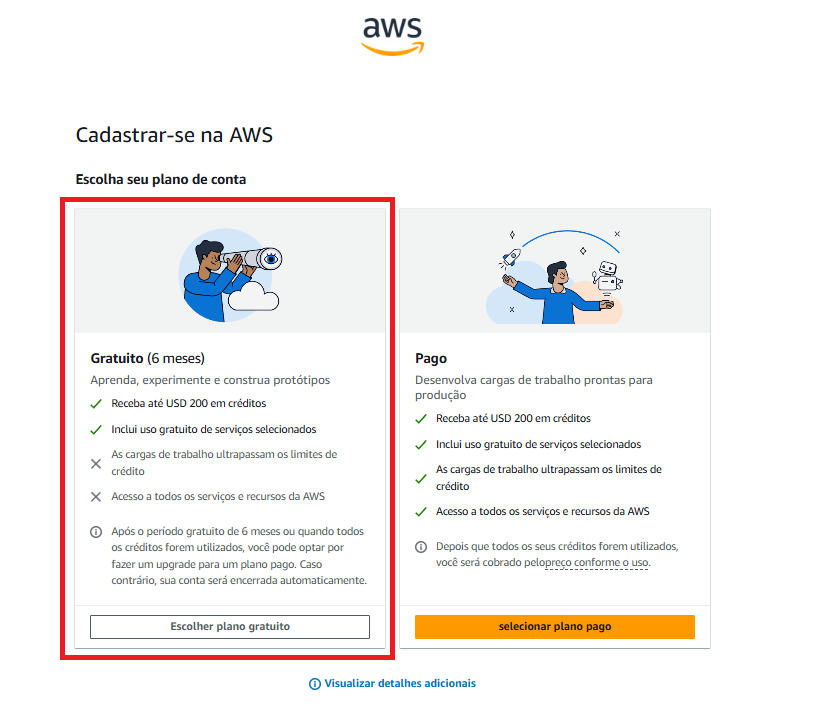

Passo 01

Acesse o site da AWS (Free Tier) através do link
ou pelo seu buscador favorito, conforme a imagem:

  

<i>(Imagem: Criando uma conta na AWS)</i>
---
  
  

Passo 02

No site da AWS clique no botão "Criar uma conta gratuita".

  

<i>(Imagem: Criando uma conta na AWS)</i>
---
  
  

Passo 03

Para ter acesso aos serviços da AWS é necessário informar um e-mail e um nome para a conta.

  

<i>(Imagem: Criando uma conta na AWS)</i>
---
  
  

Passo 04

Digite o e-mail para cadastro e defina um nome para a nova conta AWS.

  

<i>(Imagem: Criando uma conta na AWS)</i>
---
  
  

Passo 05

Após preencher os campos Root user email address e AWS account name, clique no botão "Verfiy email address".

  

<i>(Imagem: Criando uma conta na AWS)</i>
---
  
  

Passo 06

Digite o código de segurança para avançar...

  

<i>(Imagem: Criando uma conta na AWS)</i>
---
  
  

Passo 07

Nesta etapa, é necessário digitar o codigo de segurança que foi enviado ao e-mail cadastrado na AWS.

  

<i>(Imagem: Criando uma conta na AWS)</i>
---
  
  

Passo 08

Acesse a caixa de entrada do e-mail que foi utilizado para cadastro. Abra o e-mail de "Verificação de Conta" da AWS.

  

<i>(Imagem: Criando uma conta na AWS)</i>
---
  
  

Passo 09

Copie o código de segurança que está no e-mail.

  

<i>(Imagem: Criando uma conta na AWS)</i>
---
  
  

Passo 10

Digite o código de segurança no campo "Verification code" e clique em "Verify".

  

<i>(Imagem: Criando uma conta na AWS)</i>
---
  
  

Passo 11

Com a confirmação do código de segurança, a AWS exige a criação de uma senha forte para a nova conta.

  

<i>(Imagem: Criando uma conta na AWS)</i>
---
  
  

Passo 12

Definia uma senha forte para a conta, em seguida, clique em "Continue (Step 1 of 5)"

  

<i>(Imagem: Criando uma conta na AWS)</i>
---
  
  

Passo 13

Escolha o plano da conta AWS. Neste caso, escolhemos a opção "Plano Gratuito".

  

<i>(Imagem: Criando uma conta na AWS)</i>

Definindo o plano gratuito para a conta AWS.

  

<i>(Imagem: Criando uma conta na AWS)</i>
  
---
  
  

Passo 14

Preencha os campos das Informações de Contato.

  

<i>(Imagem: Criando uma conta na AWS)</i>
---
  
  

Passo 15

Preencha os campos com as Informações de Faturamento. É necessário possuir cartão de crédito para finalizar o cadastro. 

  

<i>(Imagem: Criando uma conta na AWS)</i>
---
  
  

Passo 16

Aguarde enquanto a AWS configura a nova conta...

  

<i>(Imagem: Criando uma conta na AWS)</i>
---
  
  

Passo 17

Pronto! A conta AWS foi criada com sucesso...

Clique em "Acesse o Controle de Gerenciamento da AWS" para acessar o Painel de Controle.

  

<i>(Imagem: Criando uma conta na AWS)</i>
---

  

Passo 18

A conta da AWS foi criada, abaixo segue representação do Painel de Controle.

  

<i>(Imagem: Criando uma conta na AWS)</i>
---
  
  
