# Criando uma instância EC2 na AWS

O Amazon EC2 (Elastic Compute Cloud) é um serviço da AWS que fornece servidores virtuais em uma nuvem segura e redimensionável. No contexto de DevOps, essa definição ganha um peso prático, deixando de ser apenas uma máquina virtual comum e passando a funcionar como parte de uma infraestrutura que pode ser automatizada e recriada conforme a necessidade.

---

<br></br>

## Pré-requisitos

- Possuir uma conta ativa na [Amazon Web Services (AWS)](https://aws.amazon.com/pt/).
- Consultar as instruções de [criação de uma conta na AWS](https://github.com/7hiagoreis/linuxtips-estudos-devops/blob/main/docs/aws/01-criando-uma-conta-na-aws.md).

---

<br></br>

## Configuração da EC2

### Passo 1. Acessar o Painel do EC2

1. Acesse o site da AWS [AWS Management Console]([https://console.aws.amazon.com/) e clique no botão, "Faça login no console".

<p align="center"> 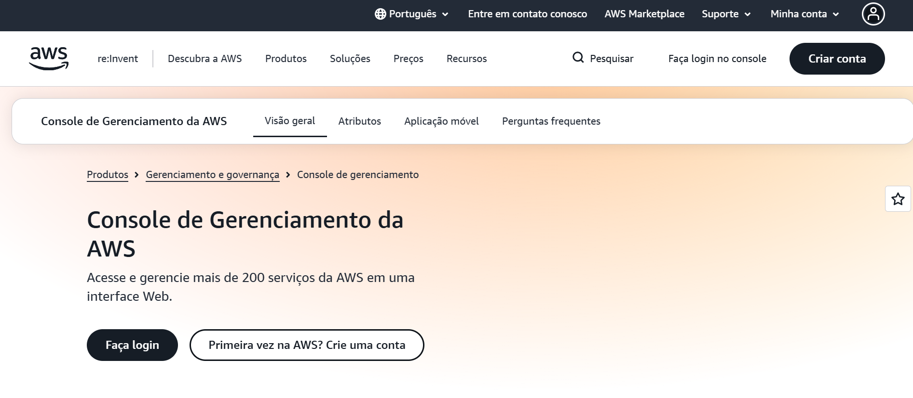 </p>
<p align="right"><i>(Imagem 01: Acessando o Console da AWS)</i>

---

<br></br>

2. Na tela de login, clique em "Sign in using root user email".

<p align="center"> 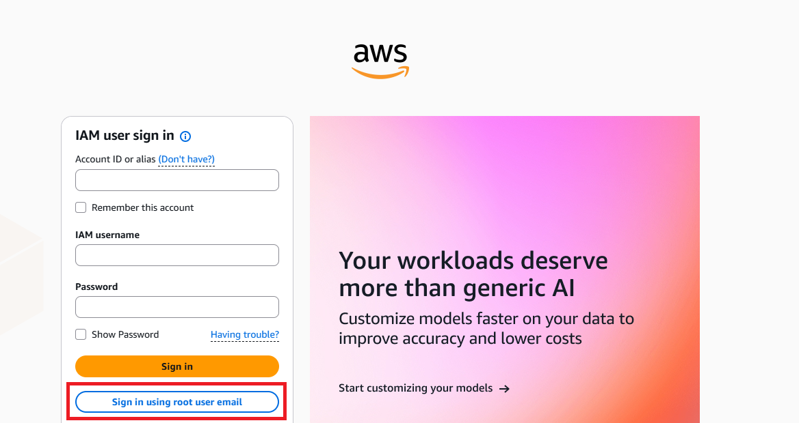 </p>
<p align="right"><i>(Imagem 02: Definindo o tipo de usuário para acessar a conta)</i>

---

<br></br>

3. Nesta parte, Tipo de Usuário (User type), selecione a opção "Root user".

<p align="center"> 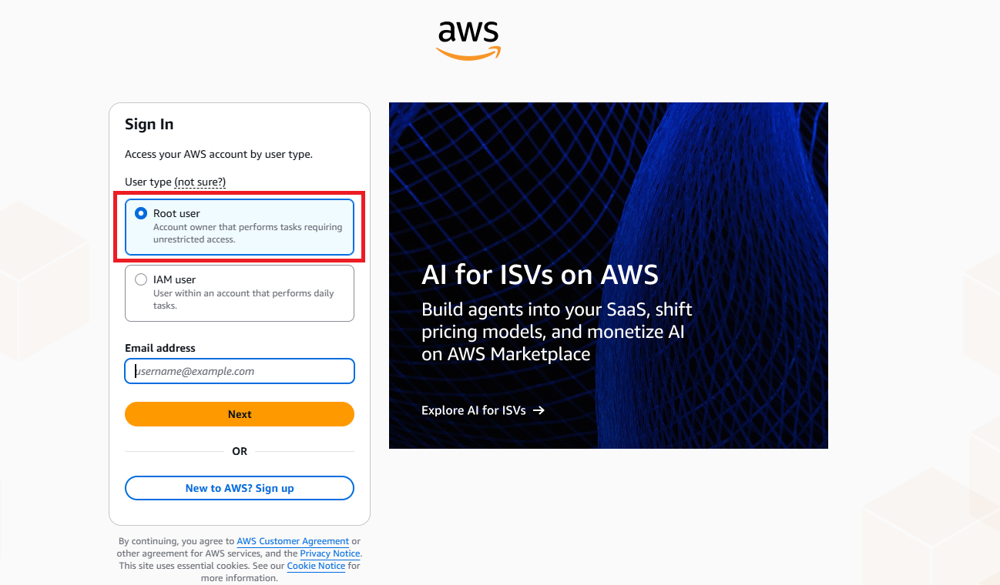 </p>
<p align="right"><i>(Imagem 03: Tipo de usuário (User type) / Root user)</i>

---

<br></br>

4. Digite o e-mail cadastrado na AWS com acesso ao Painel de Controle.

<p align="center"> 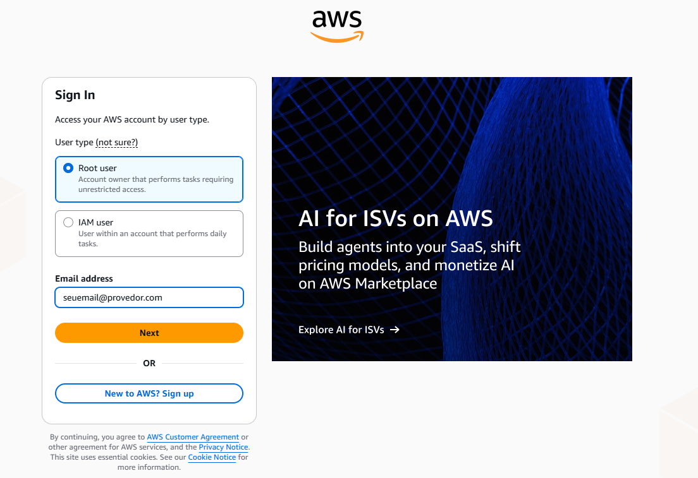 </p>
<p align="right"><i>(Imagem 04: Digite o e-mail de acesso)</i>

---

<br></br>

5. Digite a senha do e-mail de acesso ao Painel de Controle.

<p align="center"> 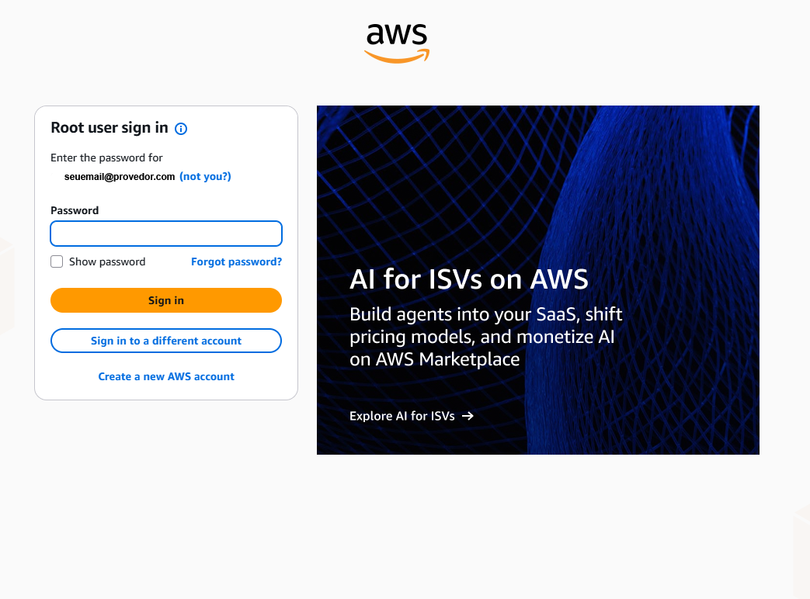 </p>
<p align="right"><i>(Imagem 05: Digite a senha do e-mail de acesso)</i>

---

<br></br>

6. Após digitar a senha, clique em "Sign in" para entrar no Painel de Controle AWS.

<p align="center"> 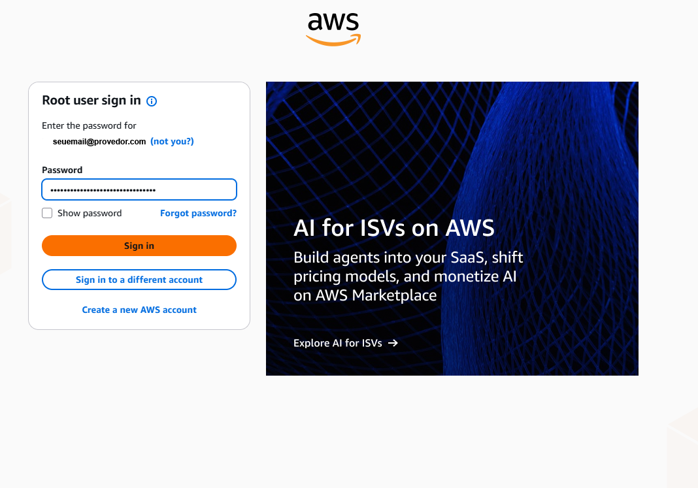 </p>
<p align="right"><i>(Imagem 06: Entrando no Painel de Controle AWS)</i>

---

<br></br>

7. Com o Painel de Controle aberto, agora precisamos acessar a área do EC2 para criar o servidor virtual.

<p align="center"> 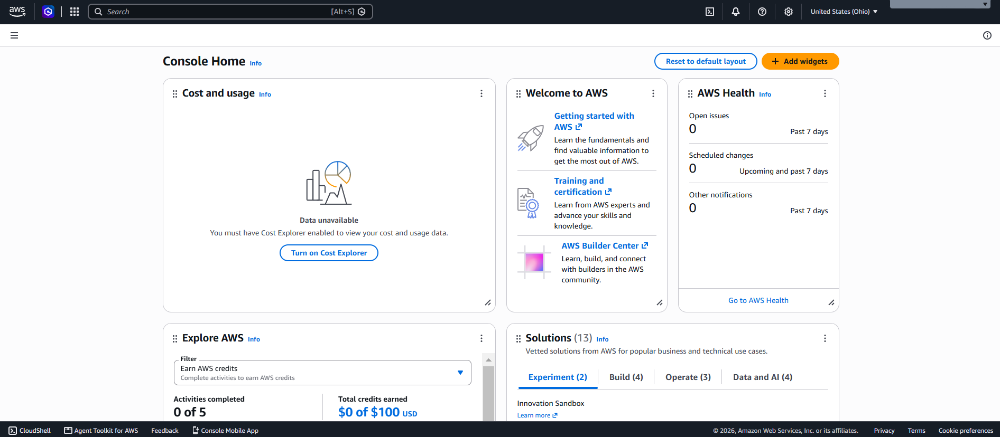 </p>
<p align="right"><i>(Imagem 07: Painel de Controle AWS)</i>

---

<br></br>

8. Na barra de pesquisa no topo da página, digite `EC2` e selecione o serviço correspondente.

<p align="center"> 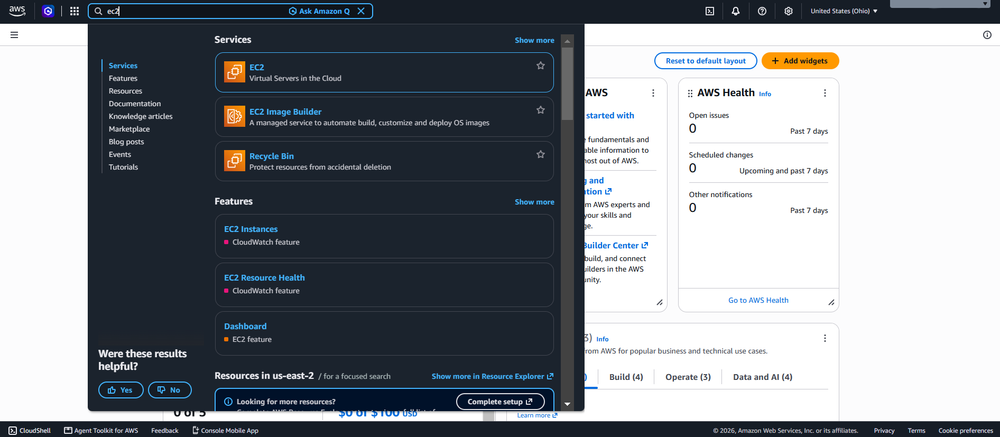 </p>
<p align="right"><i>(Imagem 08: Painel de Controle / Pesquisando EC2)</i>

---

<br></br>

9. Dica: Você pode utilizar as teclas <kbd>Alt</kbd> + <kbd>S</kbd> para ativar o acesso rápido ao menu Pesquisar...

<p align="center">  </p>
<p align="right"><i>(Imagem 09: Painel de Controle / Criando EC2)</i>

---

<br></br>

10. Clique em EC2 para acessar a parte de criação de servidores virtuais.

<p align="center"> 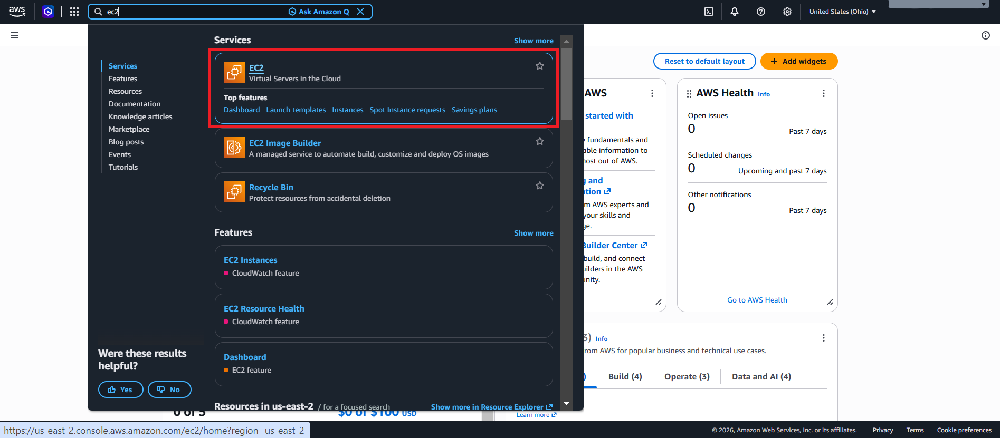 </p>
<p align="right"><i>(Imagem 10: Painel de Controle / Criando EC2)</i>

---

<br></br>

11. Este é o Painel do Elastic Compute Cloud (EC2), onde podemos criar o servidor virtual na AWS.

<p align="center"> 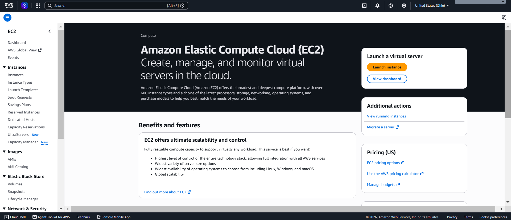 </p>
<p align="right"><i>(Imagem 11: Painel de Controle / Criando EC2)</i>

---

<br></br>

12. No canto superior direito, verifique e selecione a região onde deseja hospedar o servidor, como Norte da Virgínia `(us-east-1)` ou São Paulo `(sa-east-1)`.

<p align="center"> 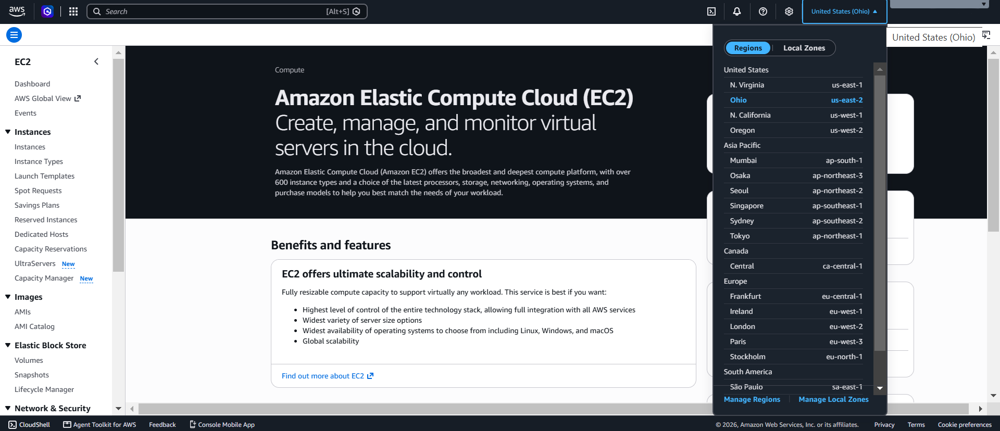 </p>
<p align="right"><i>(Imagem 12: Painel de Controle / Criando EC2)</i>

---

<br></br>

13. Neste laboratório, utilizaremos a região padrão da conta, Ohio `(us-east-2)`.

<p align="center"> 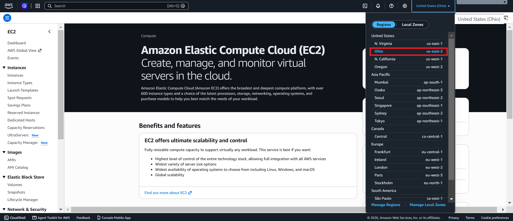 </p>
<p align="right"><i>(Imagem 13: Painel de Controle / Criando EC2)</i>

---

<br></br>

### Passo 2. Acessar o Painel do EC2

1. No painel do EC2, clique em Executar instância (Launch instance).

<p align="center"> 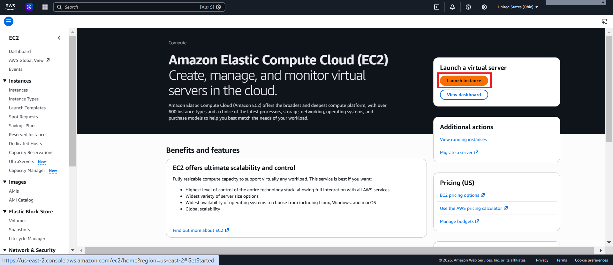 </p>
<p align="right"><i>(Imagem 14: Painel de Controle / Criando EC2)</i>

---

<br></br>

2. Em Guia oficial da AWS, pularemos esta etapa. Este guia é recomendado para novas contas na AWS.

<p align="center"> 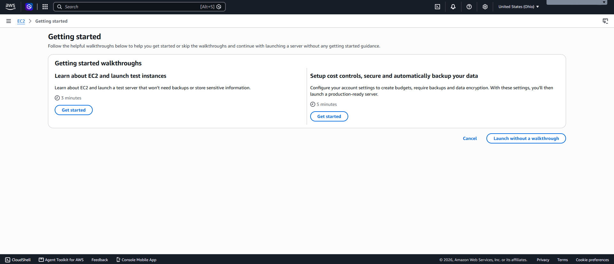 </p>
<p align="right"><i>(Imagem 15: Painel de Controle / Criando EC2)</i>

---

<br></br>

3. Para ignorar a etapa do Guia oficial da AWS, clique em "Launch without a walkthrough"

<p align="center"> 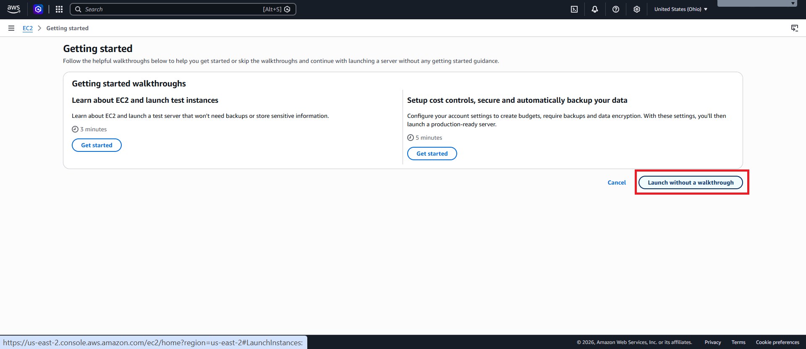 </p>
<p align="right"><i>(Imagem 16: Painel de Controle / Criando EC2)</i>

---

<br></br>

### Passo 3. Configurar os atributos principais

1. Preencha as seções do assistente de criação conforme as orientações abaixo.

| Seção | O que selecionar ou preencher | Observações |
|---|---|---|
| Nome e tags | Informe um nome para identificar a máquina, como `MeuServidor-DevOps`. | Ajuda na organização dos recursos. |
| Imagens de aplicativos e sistema operacional (AMI) | Selecione o sistema operacional desejado, como Ubuntu ou Amazon Linux. | Verifique as imagens disponíveis e as condições de elegibilidade para o plano da AWS. |
| Tipo de instância | Selecione `t3.micro` ou a instancia disponível no Free Tier | A disponibilidade e as condições de cobrança dependem da região e do plano da conta. |
| Par de chaves (login) | Clique em **Criar novo par de chaves**, informe um nome e selecione o tipo de chave e o formato do arquivo. | Use `.pem` para OpenSSH ou `.ppk` para PuTTY. Guarde a chave privada em local seguro, pois ela não poderá ser baixada novamente. |

<br></br>

<p align="center"> 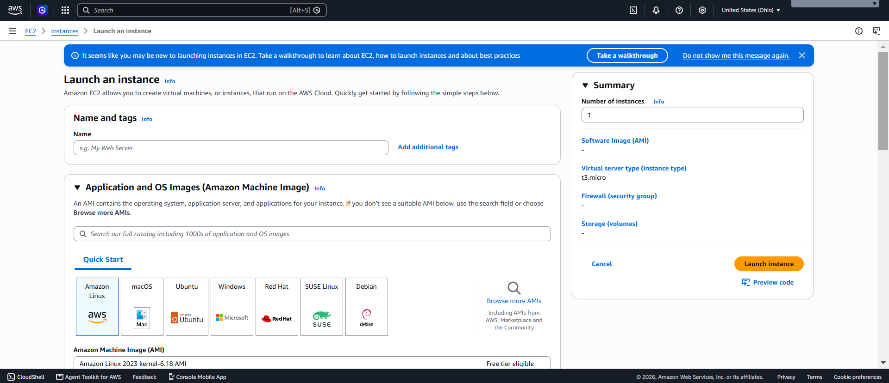 </p>
<p align="right"><i>(Imagem 17: Painel de Controle / Criando EC2)</i>

---

<br></br>

2. No campo `Name and tags`, defina o nome da sua instância. Neste exemplo, nome da instância é `MeuServidor-DevOps`.

<p align="center"> 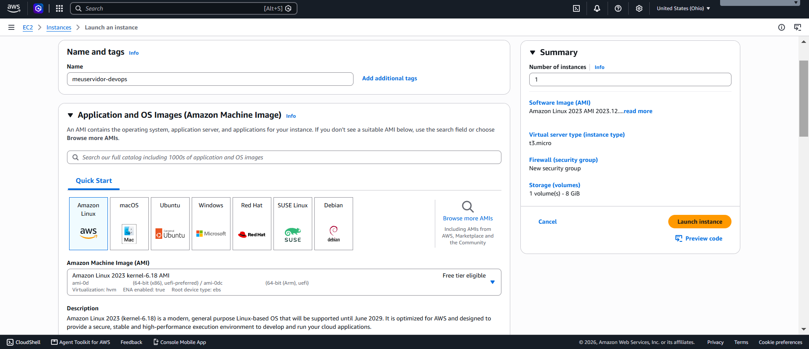 </p>
<p align="right"><i>(Imagem 18: Painel de Controle / Criando EC2)</i>

---

<br></br>

---

3. Selecione a imagem do sistema operacional que será instalado na instância. Neste exemplo, foi selecionado o `Ubuntu Server`.

<p align="center"> 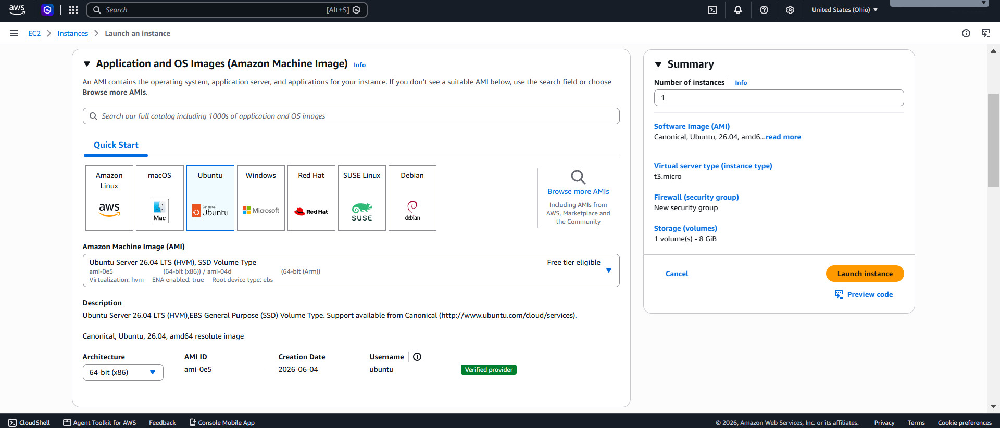 </p>
<p align="right"><i>(Imagem 19: Selecionando a imagem do sistema operacional)</i>

---

<br></br>

4. Em Tipo de Instância (Instance type), é possível escolher as configurações do servidor virtual e consultar os custos da infraestrutura.

<p align="center"> 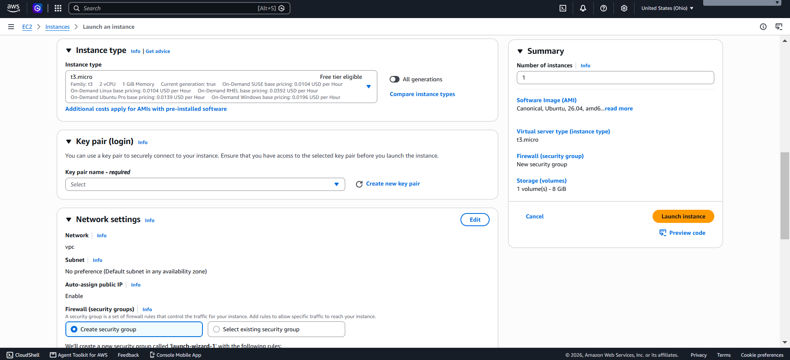 </p>
<p align="right"><i>(Imagem 20: Painel de Controle / Criando EC2)</i>

---

<br></br>

5. Para este exemplo, iremos utilizar a instância `t3.micro` (disponível no plano Free Tier).

<p align="center"> 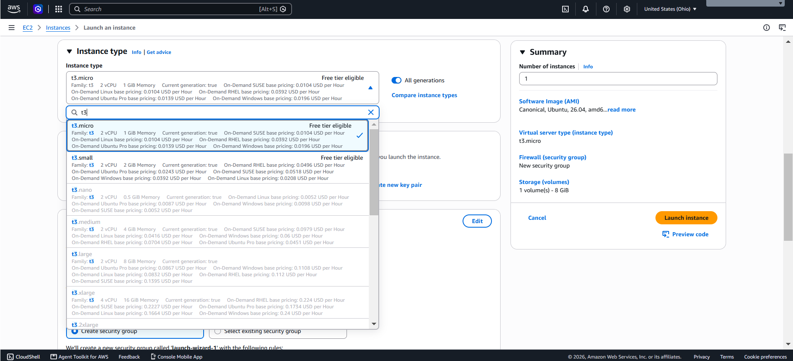 </p>
<p align="right"><i>(Imagem 21: Definindo a Instância / Criando EC2)</i>

---

<br></br>

6. Key pair (login): Permite criar Par de chaves para acesso a instância EC2. 

<p align="center"> 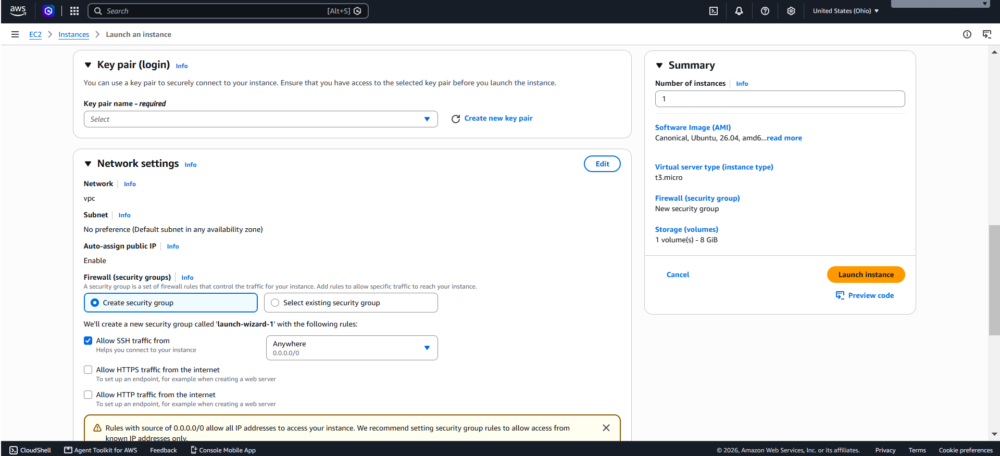 </p>
<p align="right"><i>(Imagem 22: Painel de Controle / Criando EC2)</i>

---

<br></br>

7. Clique em <kbd>Create new key par</kbd> (Criar novo par de chaves). 

<p align="center"> 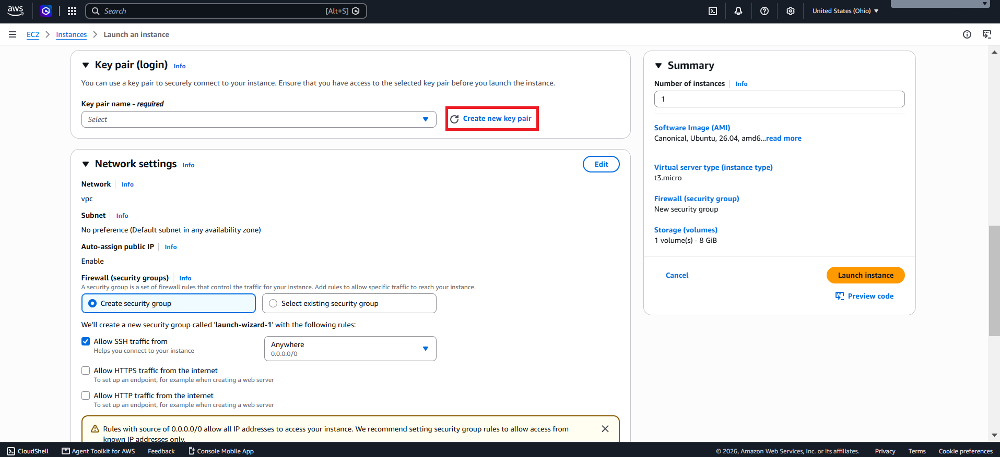 </p>
<p align="right"><i>(Imagem 23: Painel de Controle / Criando EC2)</i>

---

<br></br>

8. A tela exibida a seguir é a "Create key par", nesta etapa é possível definir o tipo de chave e formato.

<p align="center"> 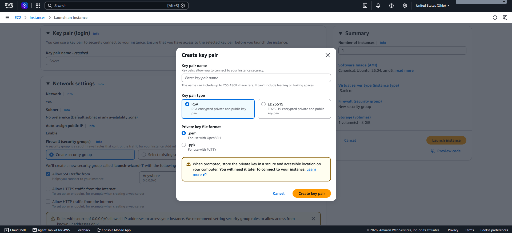 </p>
<p align="right"><i>(Imagem 24: Painel de Controle / Criando EC2)</i>

---

<br></br>

9. Em Key pair name, defina um nome para a sua chave. Mantemos as configurações, apenas definindo um nome para a chave.

Exemplo:

Key pair name = nomedasuachave-ec2
Key pair type = RSA
Private Key file format = .pem

Definida as configurações da chave, clique em "Create key pair"

<p align="center"> 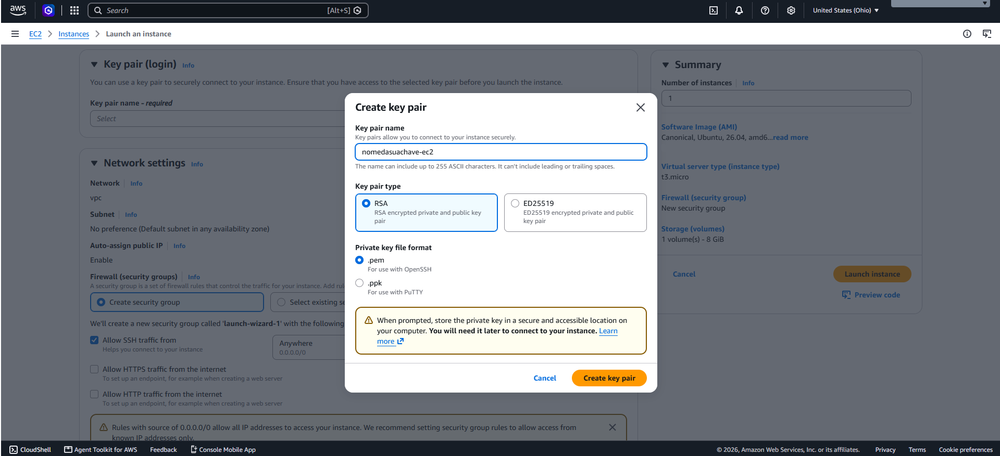 </p>
<p align="right"><i>(Imagem 25: Painel de Controle / Criando EC2)</i>

---

<br></br>

10. Network settings (Configurações de Rede), aqui mantemos as configurações padrão para a criação de rede. Habilitando apenas a opção Allow SSH traffic from, de acordo com a imagem a seguir.

Os grupos de segurança funcionam como um firewall virtual, controlando o tráfego de entrada e saída da instância.

| Configuração | Opção recomendada | Finalidade |
|---|---|---|
| Grupo de segurança | Crie um novo grupo ou selecione um existente. | Define as regras de acesso à instância. |
| Tráfego SSH (porta 22) | Selecione **Meu IP**. | Permite o acesso remoto ao terminal a partir do endereço IP autorizado. |
| Tráfego HTTP/HTTPS | Habilite as portas 80 e 443 somente se necessário. | Permite o acesso a serviços web. |

Evite liberar o SSH para qualquer endereço IP (`0.0.0.0/0`) sem necessidade, pois isso expõe a porta de acesso remoto à internet.


<p align="center"> 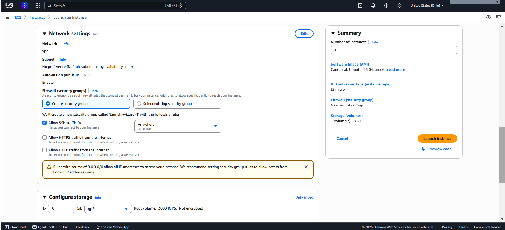 </p>
<p align="right"><i>(Imagem 26: Painel de Controle / Criando EC2)</i>

---

<br></br>

11. Em "Configure storage" é possível definir os discos virtuais e o tipo de volume para a instância.

<p align="center"> 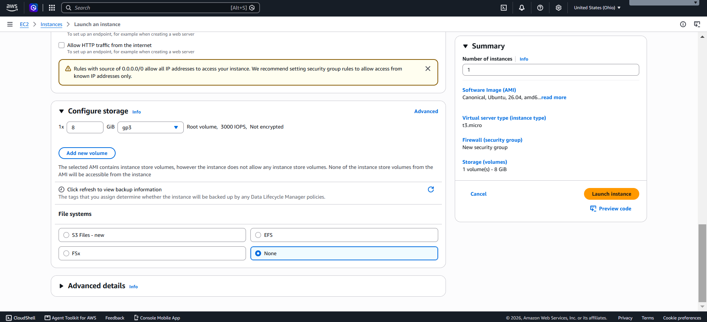 </p>
<p align="right"><i>(Imagem 27: Painel de Controle / Criando EC2)</i>

---

<br></br>

12. Neste laboratório, optamos por utilizar o disco padrão de acordo com o plano gratuito (Free Tier). Confira as condições de armazenamento inclusas no plano da AWS antes de iniciar a instância. 

Os limites e as condições de gratuidade podem variar conforme a data de criação da conta e o plano disponível. Verifique os valores atuais para evitar cobranças inesperadas.

<p align="center"> 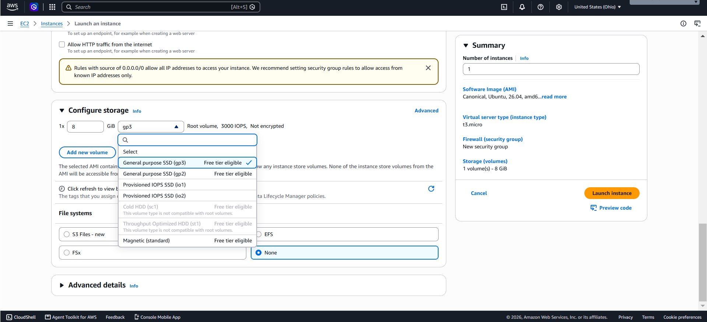 </p>
<p align="right"><i>(Imagem 28: Painel de Controle / Criando EC2)</i>

---

<br></br>

### Passo 4. Revisar e executar a instância

1. Nesta parte, podemos ver o resumo da nossa instância antes de prosseguir. A aba "Advanced details" (Detalhes Avançados) não será explorada nesta documentação, visto que é apenas um laboratório para iniciantes, escolhendo sempre o padrão e o básico para criar a instância EC2. 

Com as informações revisadas e tudo certo com a configuração, clique em "Launch instance"

<p align="center"> 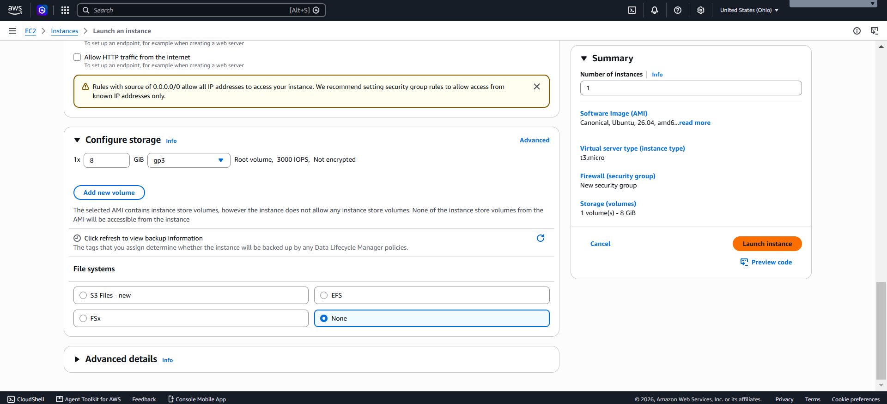 </p>
<p align="right"><i>(Imagem 29: Painel de Controle / Criando EC2)</i>

---

<br></br>

2. Aguarde enquanto o sistema carrega a instância...

<p align="center"> 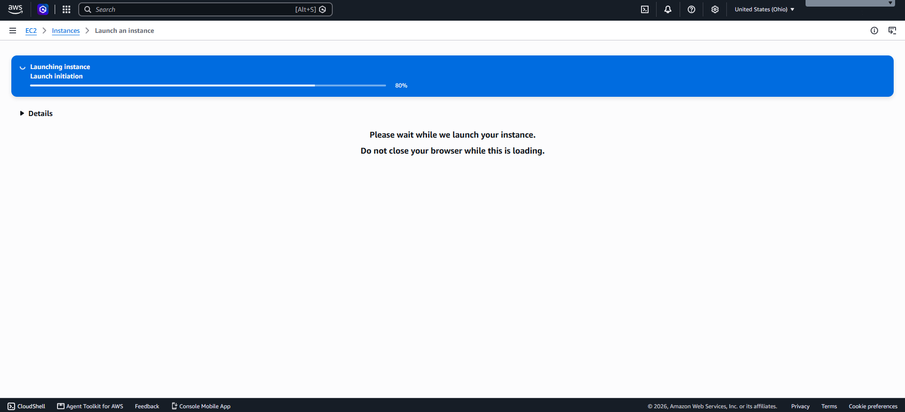 </p>
<p align="right"><i>(Imagem 30: Painel de Controle / Criando EC2)</i>

---

<br></br>

3. Pronto! A instancia foi inicializada.

<p align="center"> 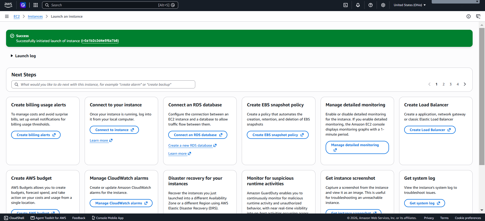 </p>
<p align="right"><i>(Imagem 31: Painel de Controle / Criando EC2)</i>

---

<br></br>

4. 

<p align="center"> 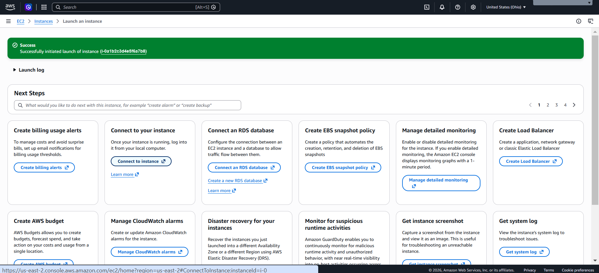 </p>
<p align="right"><i>(Imagem 32: Painel de Controle / Criando EC2)</i>

---

<br></br>

5.

<p align="center"> 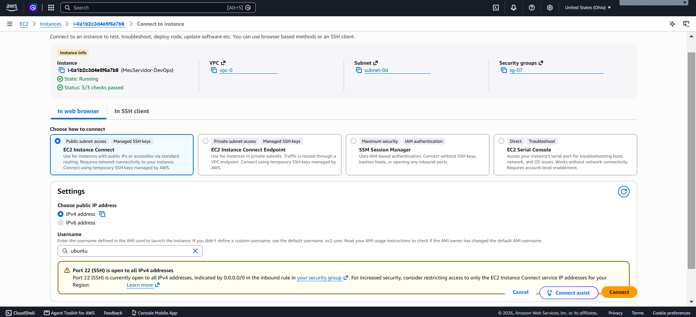 </p>
<p align="right"><i>(Imagem 33: Painel de Controle / Criando EC2)</i>

---

<br></br>

6.

<p align="center"> 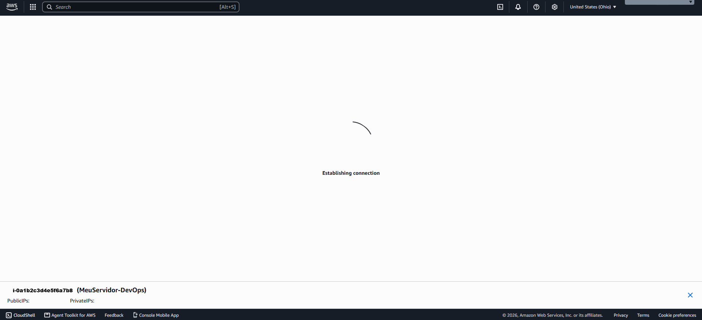 </p>
<p align="right"><i>(Imagem 34: Painel de Controle / Criando EC2)</i>

---

<br></br>

7.

<p align="center"> 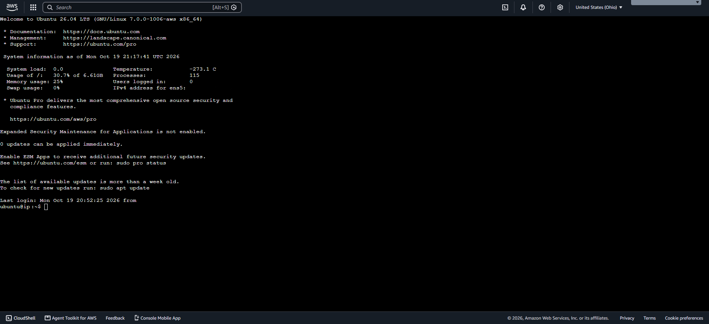 </p>
<p align="right"><i>(Imagem 35: Painel de Controle / Criando EC2)</i>

---

<br></br>

## Como conectar a instância EC2

Quando a instância estiver no estado **Em execução**, siga as etapas abaixo para acessá-la por SSH.

1. Selecione a instância no console da AWS e clique em **Conectar**.
2. Abra a aba **Cliente SSH** e consulte o comando de exemplo fornecido pela AWS.
3. Abra o terminal do computador no diretório onde a chave privada `.pem` está salva.
4. No Linux ou macOS, ajuste as permissões da chave:

```bash
   chmod 400 sua-chave.pem
```

5. Execute o comando SSH, substituindo o nome do arquivo da chave e o endereço público pelos valores da sua instância:

```bash
   ssh -i "sua-chave.pem" ubuntu@ENDERECO_PUBLICO_DA_EC2
```

Nesse exemplo, `ubuntu` é o usuário padrão de muitas imagens oficiais do Ubuntu. Para outras imagens, o nome do usuário pode ser diferente.

Em ambientes com sistema operacional Windows, o comando SSH pode ser executado pelo PowerShell com o OpenSSH instalado ou pelo terminal do WSL, caso o ambiente Linux esteja configurado. O comando `chmod` é utilizado no Linux e no macOS para ajustar as permissões da chave privada.
