# Primeiro acesso à instância EC2 pelo PuTTY

Este documento apresenta os procedimentos para realizar o primeiro acesso a uma instância Amazon EC2 utilizando o PuTTY no Windows, com autenticação por chave SSH.

---

<br></br>

## 1. Pré-requisitos

Antes de iniciar, é necessário ter:

- Uma instância EC2 criada e com o estado `Running`.
- O endereço IPv4 público da instância.
- A chave privada `.pem` selecionada durante a criação da instância.
- O PuTTY e o PuTTYgen instalados no Windows.
- Uma regra de entrada no Security Group permitindo SSH pela porta `22`, preferencialmente restrita ao IP público do computador utilizado para o acesso.

---

<br></br>

## 2. Consultar os dados da instância

Acesse o [console da AWS](https://console.aws.amazon.com/) e navegue até:

**EC2 → Instances → Selecione a instância**

Na tela de detalhes, localize as seguintes informações:

| Informação | Descrição |
|---|---|
| Instance ID | Identificador da instância EC2 |
| Instance state | Deve estar como `Running` |
| Public IPv4 address | Endereço público utilizado para a conexão |
| AMI | Imagem do sistema operacional instalado |
| Key pair name | Nome do par de chaves selecionado na criação |

<br></br>

O endereço IPv4 público será utilizado na configuração do PuTTY. Neste exemplo o endereço IP da instância é `3.145.4.156`

<p align="center"> 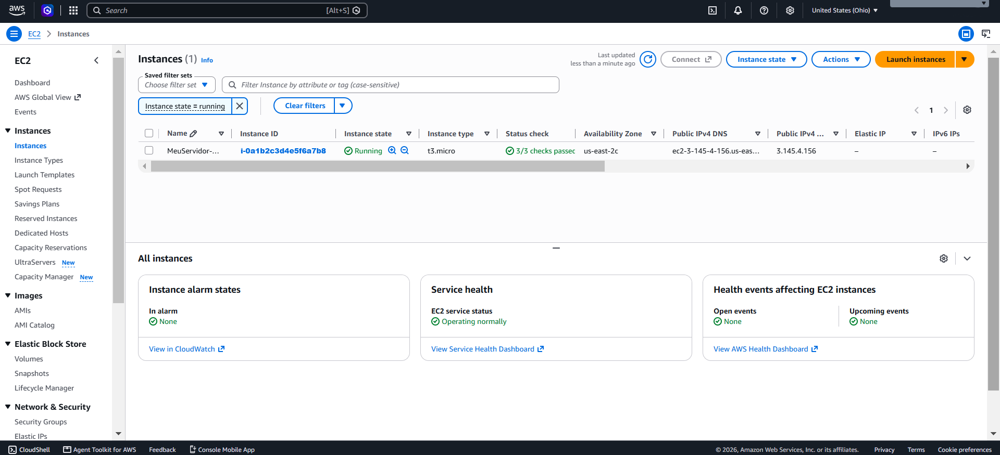 </p>
<p align="right"><i>(Imagem 01: Painel de Controle EC2 / Instâncias)</i>

---

<br></br>

## 3. Converter a chave PEM para PPK

O PuTTY utiliza normalmente o formato `.ppk` para autenticação por chave privada. Caso a versão instalada não aceite diretamente o arquivo `.pem`, será necessário convertê-lo utilizando o PuTTYgen.

1. Abra o PuTTYgen.

<p align="center"> 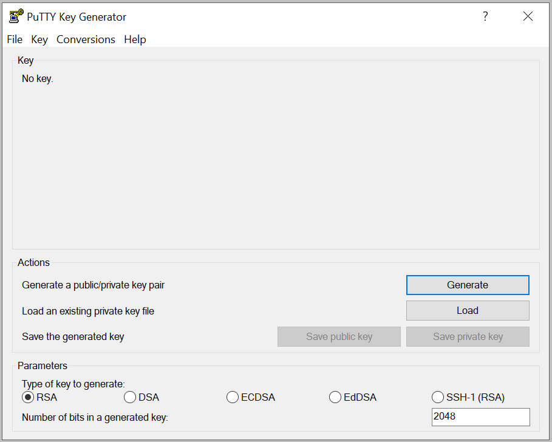 </p>
<p align="right"><i>(Imagem 02: PuTTYgen / Tela Principal)</i>

---

<br></br>


2. Clique em **Load** para carregar a chave privada.

<p align="center"> 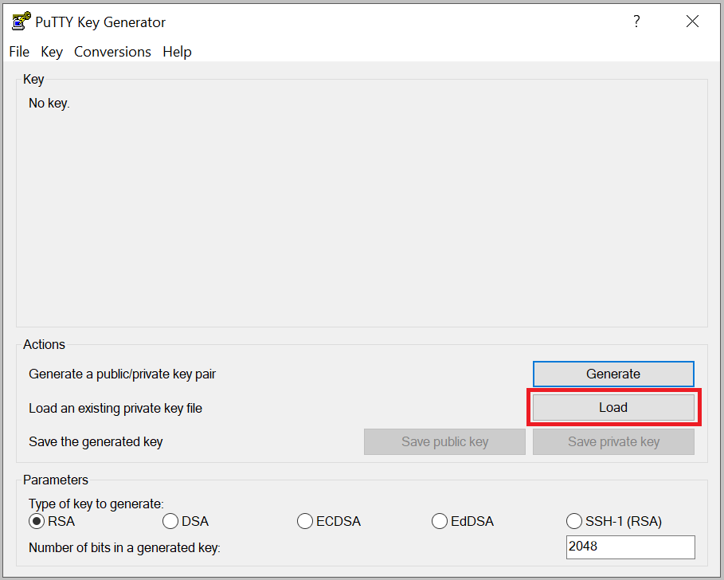 </p>
<p align="right"><i>(Imagem 03: Carregando a chave privada no PuTTYgen)</i>

---

<br></br>

3. No canto  inferior direito da janela, altere o filtro de arquivos para exibir todos os tipos. 

<p align="center"> 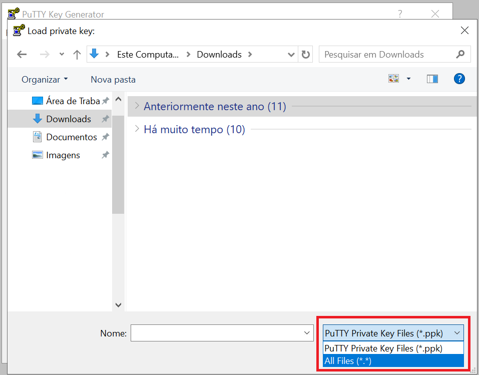 </p>
<p align="right"><i>(Imagem 04: Alterando o filtro de arquivos)</i>

---

<br></br>

4. Navegue até a pasta onde foi salva a chave e selecione o arquivo com a extensão `.pem` que foi baixado durante a criação da instância. Após selecionar a chave, clique em <kbd>Abrir</kbd>

<p align="center"> 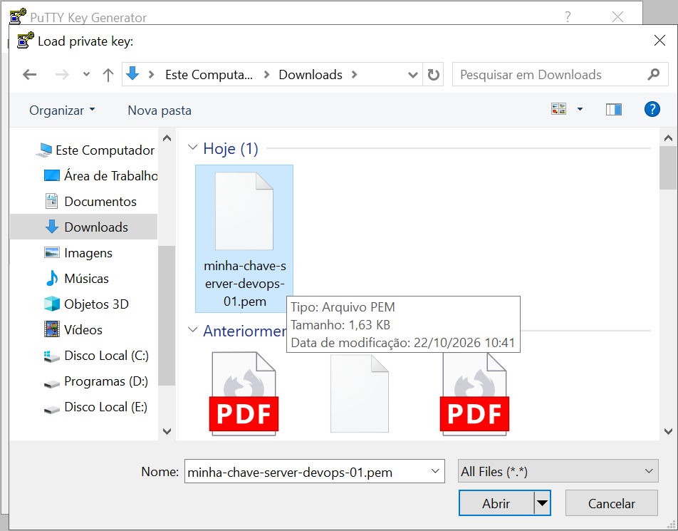 </p>
<p align="right"><i>(Imagem 05: Selecionando a chave privada)</i>

---

<br></br>

5. O PuTTYgen vai confirmar se a chave privada foi importada. Clique em <kbd>OK</kbd> para continuar...

<p align="center"> 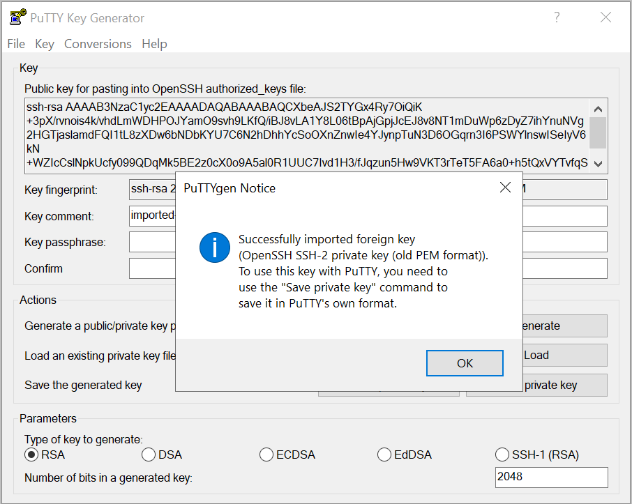 </p>
<p align="right"><i>(Imagem 06: Alterando o filtro de arquivos)</i>

---

<br></br>

6. Com a importação da chave privada para o PuTTYgen, é possível definir uma senha (passphrase) para acesso a chave.

<p align="center"> 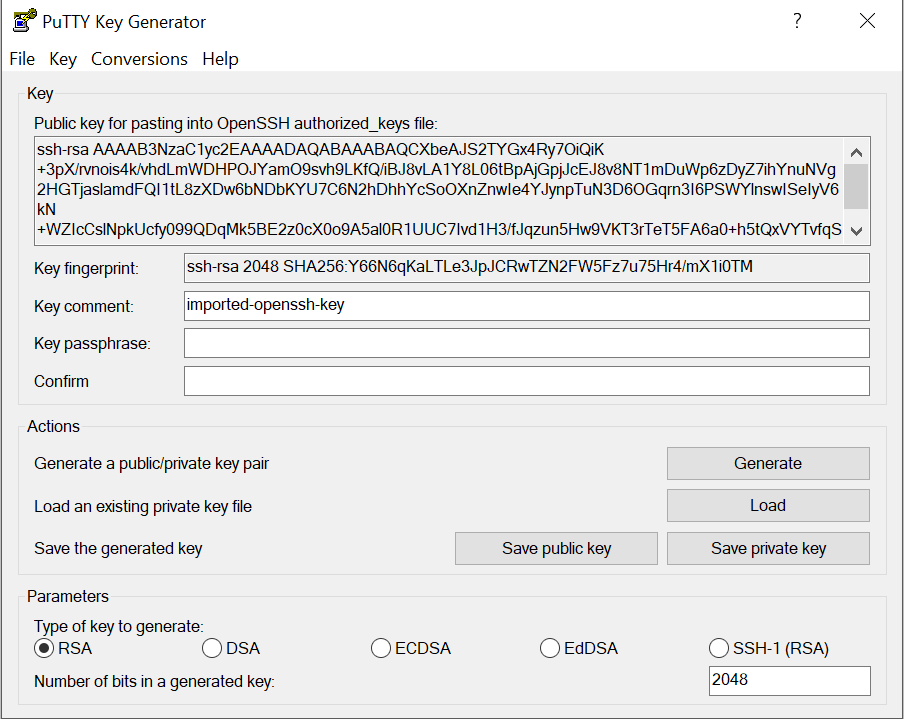 </p>
<p align="right"><i>(Imagem 07: PuTTYgen com chave privada importada")</i>

---

<br></br>

7. Neste exemplo foi definada a passphrase, se preferir, pode continuar o processo sem senha (passphrase).

<p align="center"> 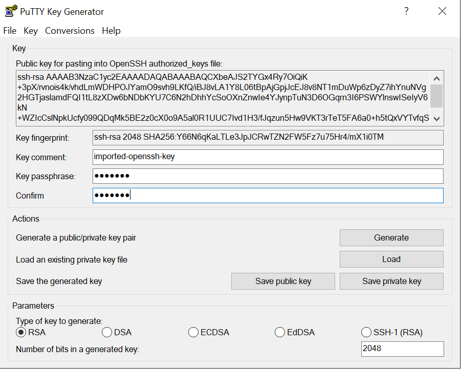 </p>
<p align="right"><i>(Imagem 08: Definindo a passphrase no PuTTYgen / Chave Privada")</i>

---

<br></br>

8. Após carregar a chave, clique em **Save private key**.

<p align="center"> 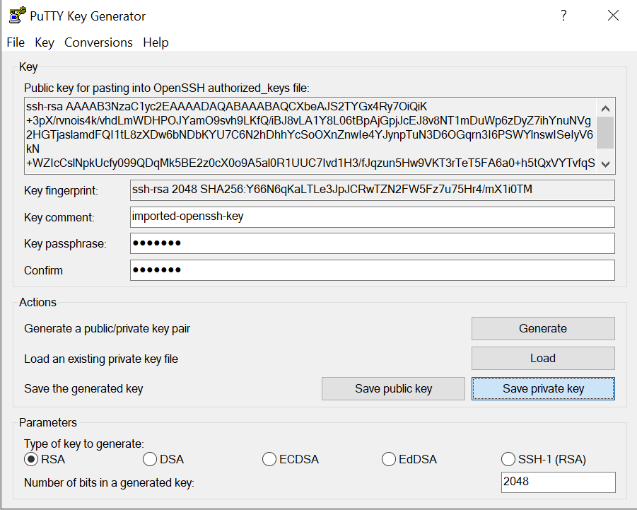 </p>
<p align="right"><i>(Imagem 09: Definindo a passphrase no PuTTYgen / Chave Privada")</i>

---

<br></br>

9. Defina um nome para a chave e salve no formato `.ppk`.

<p align="center"> 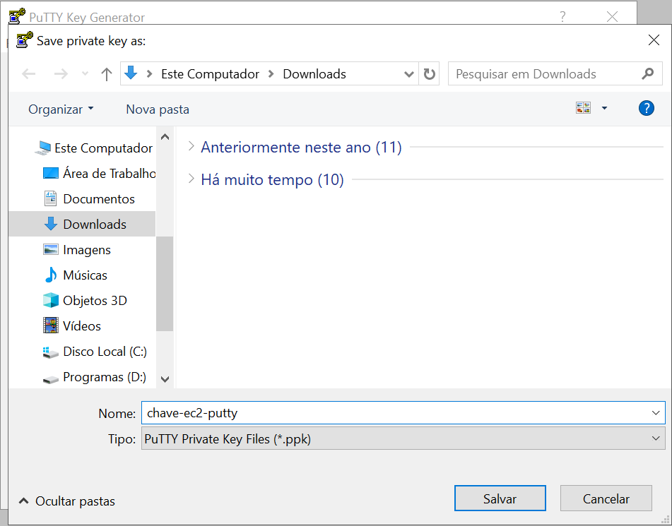 </p>
<p align="right"><i>(Imagem 10: Salvando a chave")</i>

Guarde a chave privada em um local seguro. Ela não deve ser compartilhada nem enviada para repositórios no GitHub.

---

<br></br>


## 4. Configurar o PuTTY

Abra o PuTTY e configure os parâmetros da conexão.

<p align="center"> 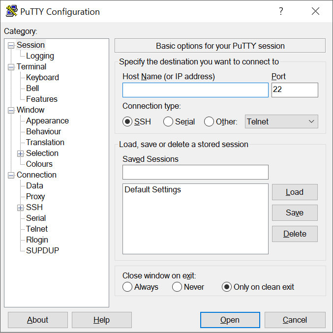 </p>
<p align="right"><i>(Imagem 11: Tela principal do PuTTY")</i>

---

<br></br>

### Informar o endereço da instância

Na categoria **Session**, preencha:

- **Host Name (or IP address):** endereço IPv4 público da instância.
- **Port:** `22`.
- **Connection type:** `SSH`.

Para uma instância Ubuntu Server, o formato do endereço será:

`IP_PUBLICO_DA_EC2`

Substitua `IP_PUBLICO_DA_EC2` pelo endereço real da instância.


<p align="center"> 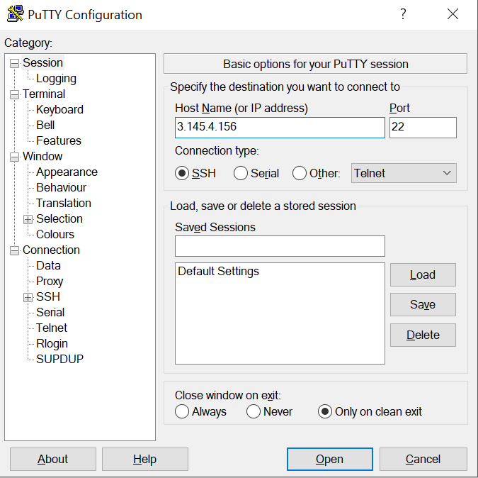 </p>
<p align="right"><i>(Imagem 12: Configuração do PuTTY")</i>

---

<br></br>


### Selecionar a chave privada

No menu lateral, navegue até:

**Connection → SSH → Auth → Credentials**


<p align="center"> 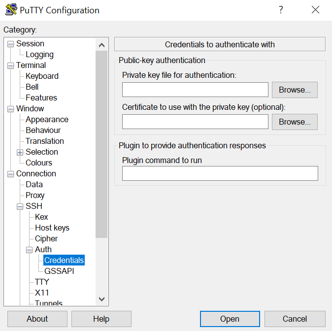 </p>
<p align="right"><i>(Imagem 13: Configurando credenciais no PuTTY")</i>

---

<br></br>

No campo de arquivo da chave privada, clique em <kbd>Browse</kbd> 

<p align="center"> 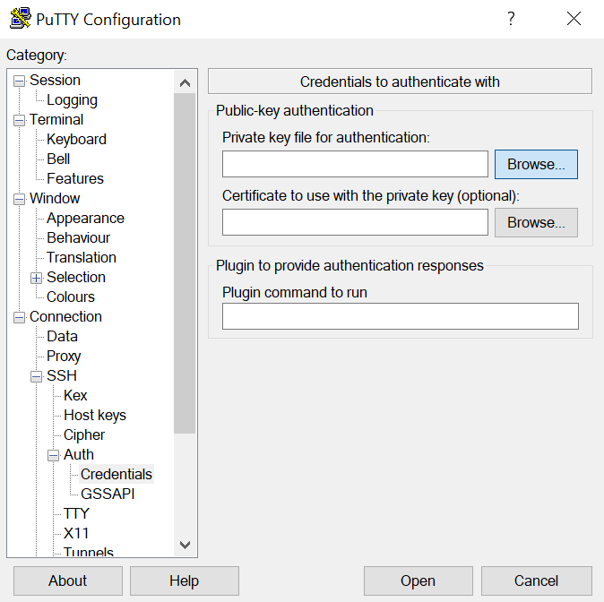 </p>
<p align="right"><i>(Imagem 14: Configurando credenciais no PuTTY")</i>

---

<br></br>


Selecione o arquivo `.ppk` gerado anteriormente e clique em <kbd>Abrir</kbd>

<p align="center"> 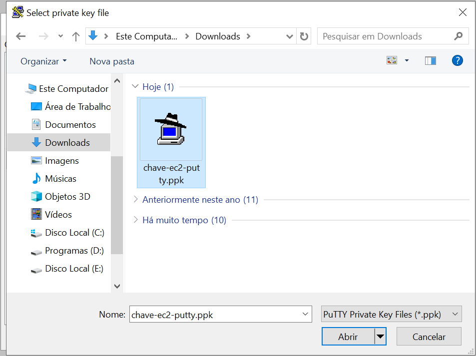 </p>
<p align="right"><i>(Imagem 15: Configurando credenciais no PuTTY")</i>

---

<br></br>

Feito isso o caminho da chave no sistema operacional vai aparecer no campo "Private key file for authentication"

<p align="center"> 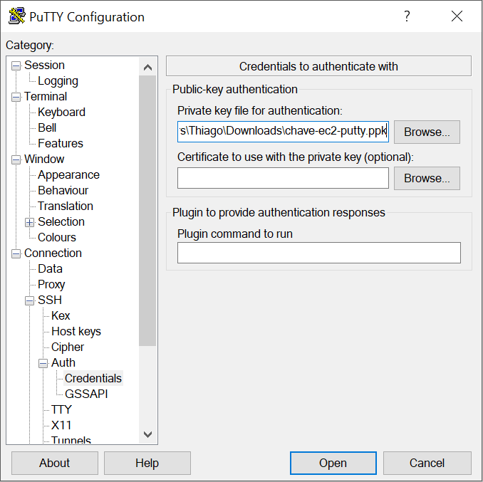 </p>
<p align="right"><i>(Imagem 16: Configurando credenciais no PuTTY")</i>

---

<br></br>

Volte à categoria **Session** para iniciar a conexão.

<p align="center"> 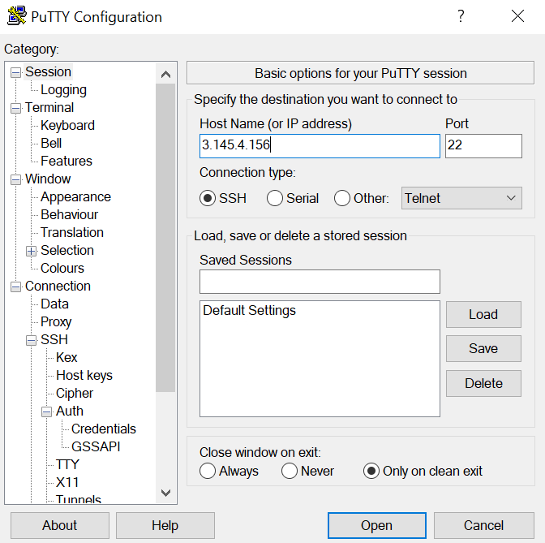 </p>
<p align="right"><i>(Imagem 17: Tela principal do PuTTY / Session)</i>

---

<br></br>


## 5. Realizar o primeiro acesso

Clique em **Open** para abrir a sessão SSH.

Na primeira conexão, o PuTTY poderá exibir um aviso sobre a chave de identificação do servidor. Confira a impressão digital (*fingerprint*) por um meio confiável antes de aceitar. Essa chave identifica o servidor remoto e é diferente da chave privada utilizada para autenticação.

<p align="center"> 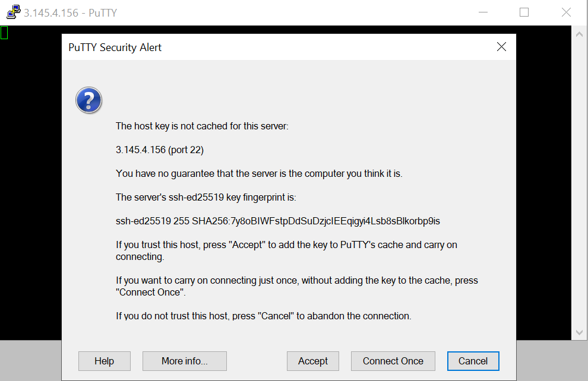 </p>
<p align="right"><i>(Imagem 18: Primeiro acesso ao EC2 com PuTTY)</i>

---

<br></br>

Clique em <kbd>Accept</kbd> para autorizar a conexão

<p align="center"> 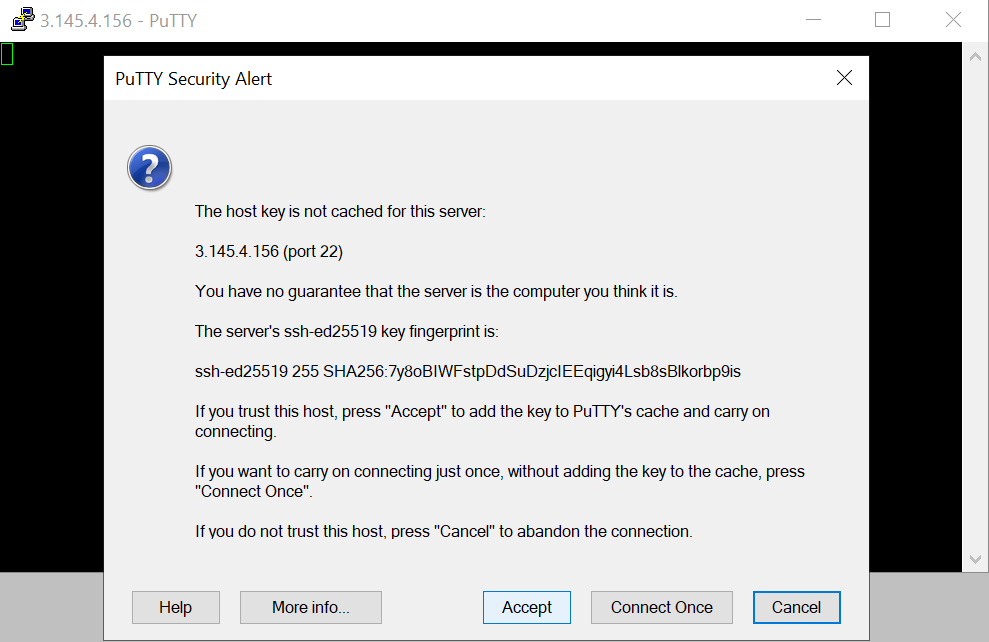 </p>
<p align="right"><i>(Imagem 19: Primeiro acesso ao EC2 com PuTTY)</i>

---

<br></br>

Digite o nome de usuário e pressione <kbd>Enter</kbd>, neste exemplo o nome de usuário é: ubuntu

<p align="center"> 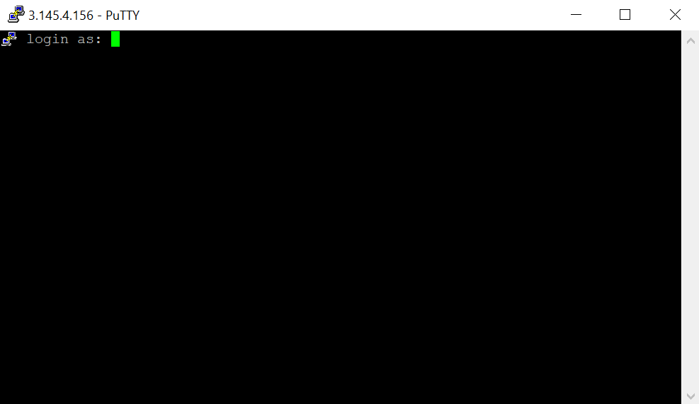 </p>
<p align="right"><i>(Imagem 20: Primeiro acesso ao EC2 com PuTTY)</i>

---

<br></br>

Em seguida, é necessário digitar a senha (passpharse) para acesso a chave privada.

<p align="center"> 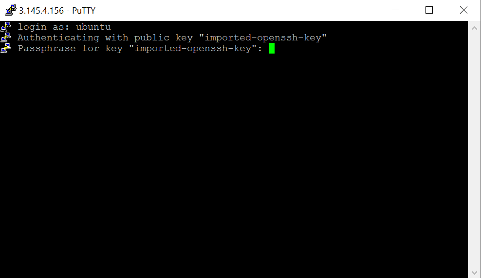 </p>
<p align="right"><i>(Imagem 21: Primeiro acesso ao EC2 com PuTTY)</i>

---

<br></br>

Pronto! O acesso a instancia EC2 foi realizado com sucesso! Após a conexão, o terminal solicitará a autenticação por chave. Com a configuração correta, o acesso será realizado sem a necessidade de informar uma senha de usuário.

<p align="center"> 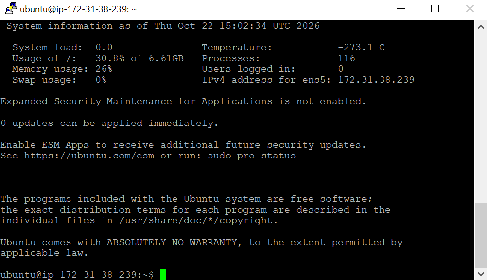 </p>
<p align="right"><i>(Imagem 22: Primeiro acesso ao EC2 com PuTTY)</i>

---

<br></br>


## 6. Validar a conexão

Após entrar na instância, execute os comandos abaixo para verificar o ambiente.

### Identificar o usuário conectado

```bash
whoami
```

<p align="center"> 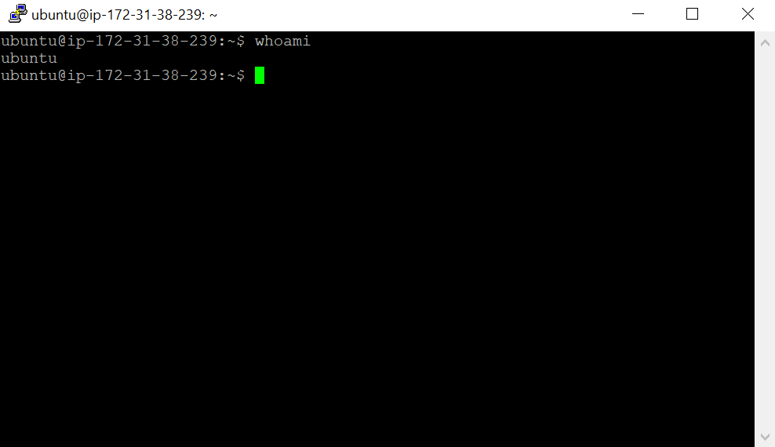 </p>
<p align="right"><i>(Imagem 23: Executando o comando whoami)</i>

---

<br></br>


### Identificar o nome do servidor

```bash
hostname
```

<p align="center"> 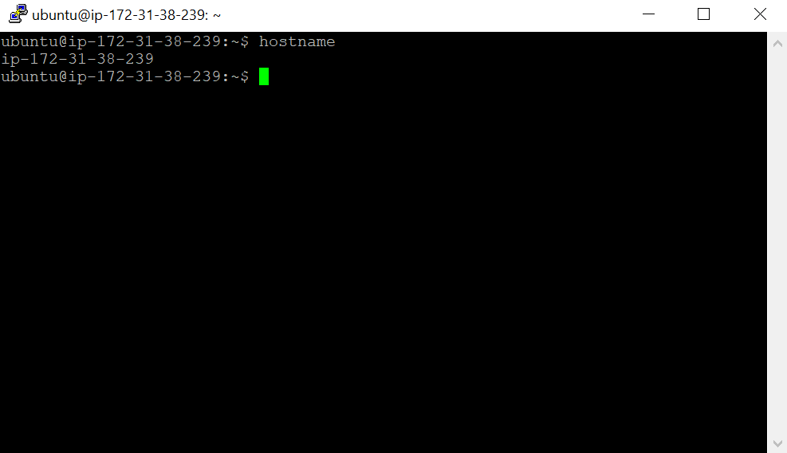 </p>
<p align="right"><i>(Imagem 23: Executando o comando hostname)</i>

---

<br></br>

### Atualizar a lista de pacotes

Em uma instância Ubuntu Server, execute:

```bash
sudo apt update
```

<p align="center"> 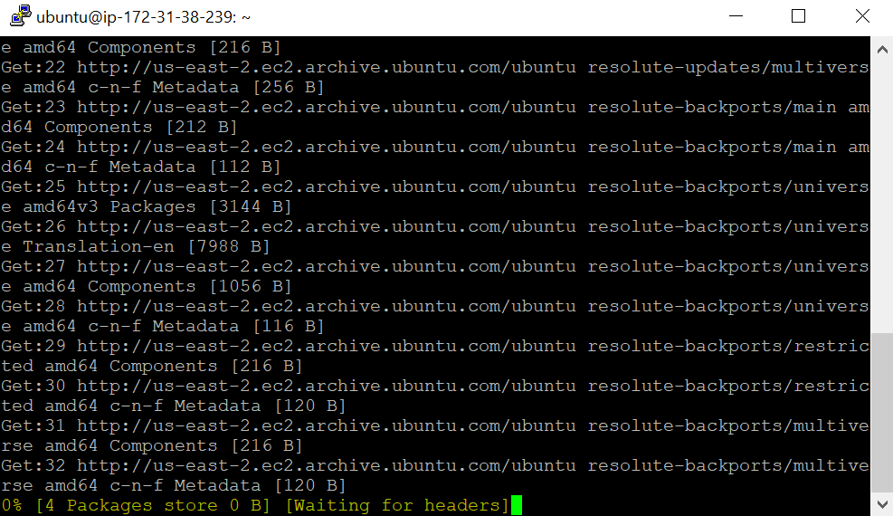 </p>
<p align="right"><i>(Imagem 24: Executando o comando update)</i>

O comando atualiza os índices dos pacotes disponíveis nos repositórios configurados, sem realizar a atualização dos pacotes instalados.

---

<br></br>

## 7. Encerrar a sessão

Para finalizar a conexão SSH, execute:

```bash
exit
```

<p align="center">  </p>
<p align="right"><i>(Imagem 25: Saindo da instância EC2)</i>

---

<br></br>

## 8. Observações de segurança

- Mantenha a chave privada `.pem` ou `.ppk` protegida.
- Nunca publique suas chaves privadas no GitHub.
- Permita conexões SSH somente a partir de endereços IP confiáveis sempre que possível.
- O acesso depende das regras de rede, do estado da instância e da configuração do sistema operacional.
- O endereço IPv4 público pode mudar após a interrupção e a inicialização da instância, dependendo da configuração utilizada.

---

<br></br>

## Referências

- [Amazon EC2](https://aws.amazon.com/ec2/)
- [Documentação do PuTTY](https://www.putty.org/)
- [Conectar-se à instância Linux usando SSH](https://docs.aws.amazon.com/AWSEC2/latest/UserGuide/connect-linux-inst-ssh.html)
