# Configurando o acesso SSH à EC2 a partir de uma VM Ubuntu Server

Procedimentos para configurar o acesso SSH a uma instância Amazon EC2 a partir de uma máquina virtual Ubuntu Server executada no VirtualBox.

O processo utiliza o comando `ssh-copy-id` para instalar uma chave pública SSH na instância remota, permitindo autenticar conexões futuras utilizando uma chave pessoal.

---

<br></br>

## 1. Pré-requisitos

Antes de iniciar, é necessário ter:

- Uma VM Ubuntu Server instalada e funcionando no VirtualBox.
- Uma instância Amazon EC2 criada e acessível.
- O primeiro acesso a EC2 validado pelo PuTTY.
- O endereço IPv4 público da instância EC2.
- A chave privada `.pem` utilizada na criação da instância.
- Acesso a internet a partir da VM Ubuntu Server.

---

<br></br>

## 2. Verificar o cliente SSH

Na VM Ubuntu Server, execute:

```bash
ssh -V
```

<br></br>

O comando exibe a versão do cliente SSH instalado.

<p align="center"> 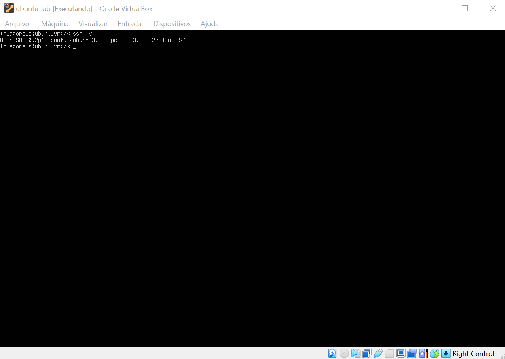 </p>
<p align="right"><i>(Imagem 01: Verificando a versão do SSH)</i>

---

<br></br>

Verifique se o comando `ssh-copy-id` está disponível:

```bash
which ssh-copy-id
```

<br></br>

<p align="center">  </p>
<p align="right"><i>(Imagem 02: Verificando se existe o binário do ssh-copy-id)</i>

---

<br></br>

Caso não esteja instalado, execute:

```bash
sudo apt update
sudo apt install openssh-client
```

---

<br></br>

## 3. Verificar as chaves SSH da VM

Liste os arquivos existentes no diretório SSH do usuário:

```bash
ls -lha ~/.ssh/
```

<p align="center"> 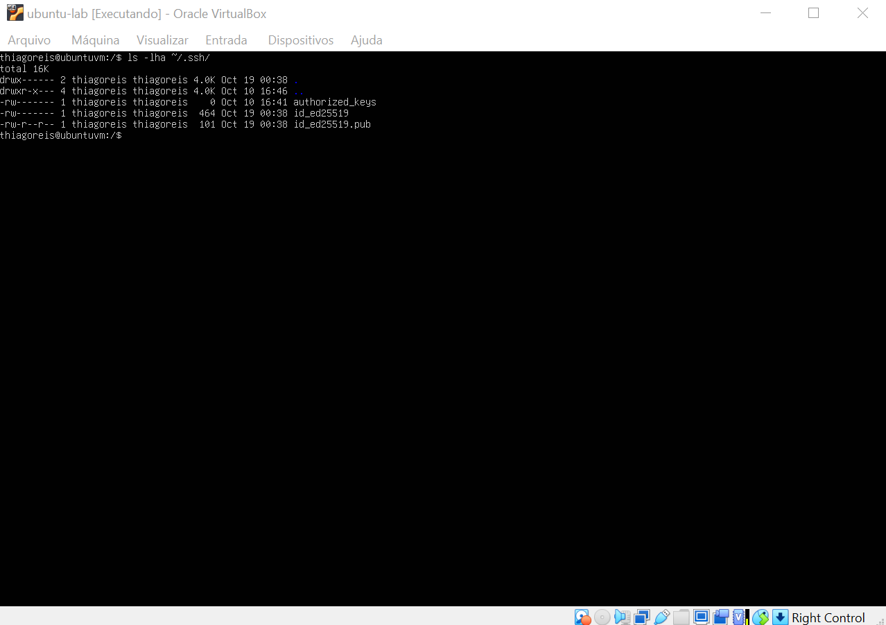 </p>
<p align="right"><i>(Imagem 03: Confirmando a existência das chaves na VM)</i>

---

<br></br>


Uma chave pessoal ed25519 utiliza normalmente dois arquivos:

- `id_ed25519`: chave privada.
- `id_ed25519.pub`: chave pública.

Caso ainda não exista uma chave pessoal, gere uma:

```bash
ssh-keygen -t ed25519
```

<p align="center">  </p>
<p align="right"><i>(Imagem 04: Confirmando a existência das chaves na VM)</i>

---

<br></br>

Aceite o caminho padrão para utilizar `~/.ssh/id_ed25519`, caso seja adequado ao ambiente.

<p align="center"> 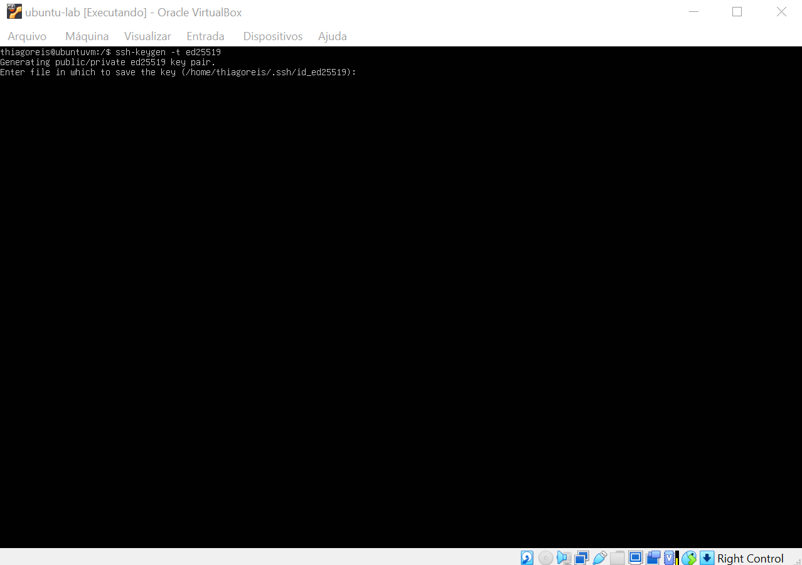 </p>
<p align="right"><i>(Imagem 05: Confirmando o caminho para salvar as chaves na VM)</i>

---

<br></br>

Defina uma senha (passpharse) para a chave privada.

<p align="center"> 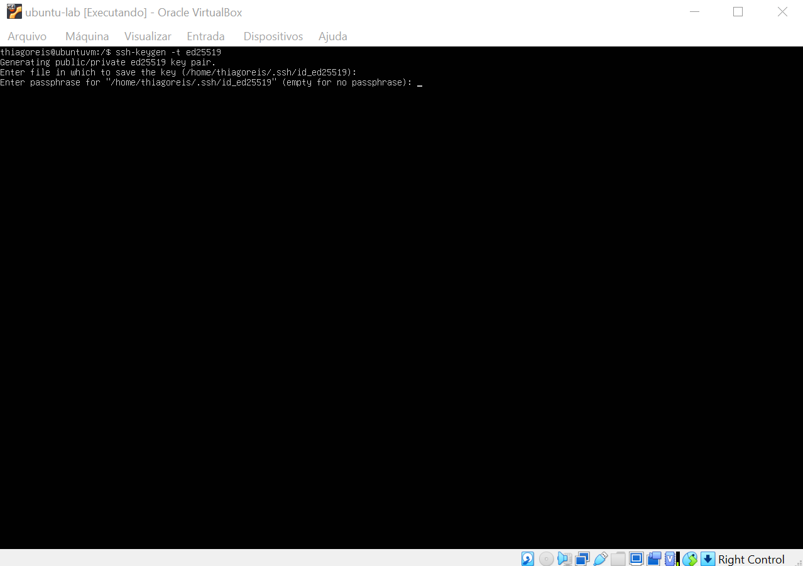 </p>
<p align="right"><i>(Imagem 06: Passpharse / Chave Privada)</i>

---

<br></br>

As chaves foram criadas! A chave privada deve permanecer protegida. Somente a chave pública, identificada pela extensão `.pub`, será instalada na instância EC2.

<p align="center"> 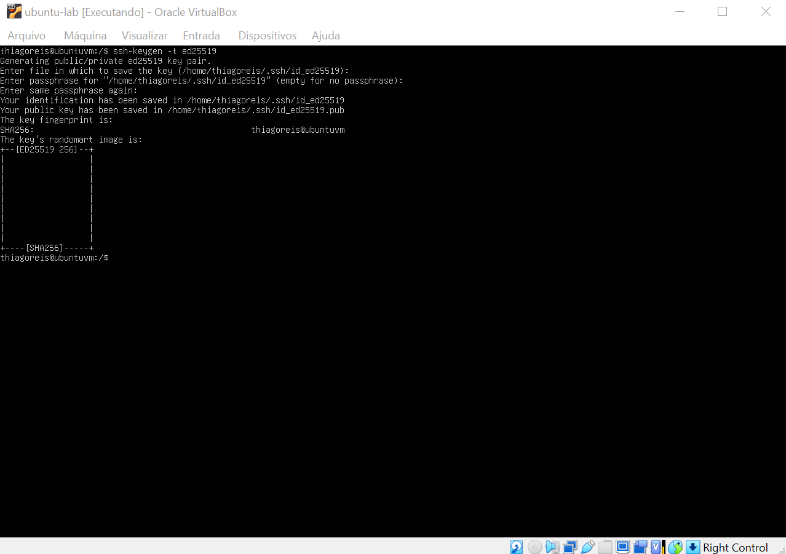 </p>
<p align="right"><i>(Imagem 06: Passpharse / Chave Privada)</i>

---

<br></br>

(EM DESENVOLVIMENTO)
## 4. Transferir a chave privada da AWS do Windows para a VM

A chave privada `.pem`, baixada durante a criação da instância EC2, está no Windows. Como a configuração do SSH será realizada a partir da VM Ubuntu Server, é necessário transferir esse arquivo para a máquina virtual.

### 4.1. Preparar a pasta compartilhada no Windows

Crie a pasta `C:\VM-Compartilhada` no Windows e copie para ela o arquivo `.pem` baixado da AWS.

<p align="center"> 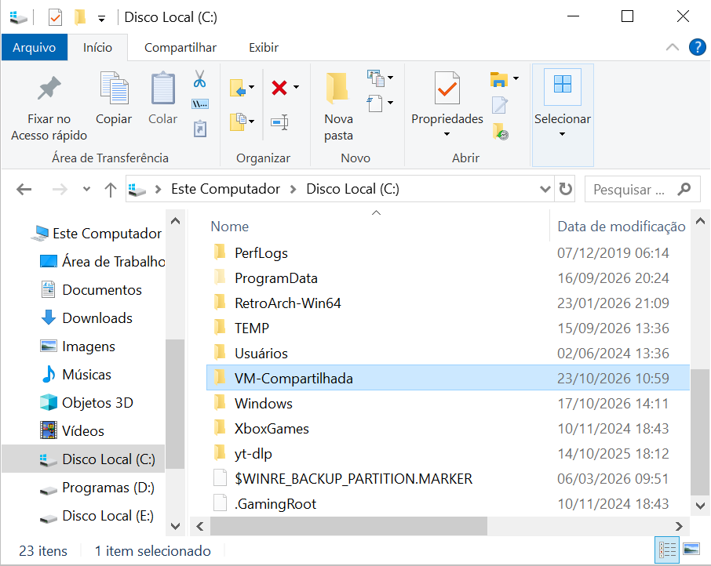 </p>
<p align="right"><i>(Imagem 07: Pasta compartilhada no Windows com a máquina virtual)</i>

---

<br></br>

### 4.2. Configurar a pasta compartilhada no VirtualBox

No VirtualBox, selecione a VM Ubuntu Server, clique com o botão direito do mouse e acesse **Configurações**.

<p align="center"> 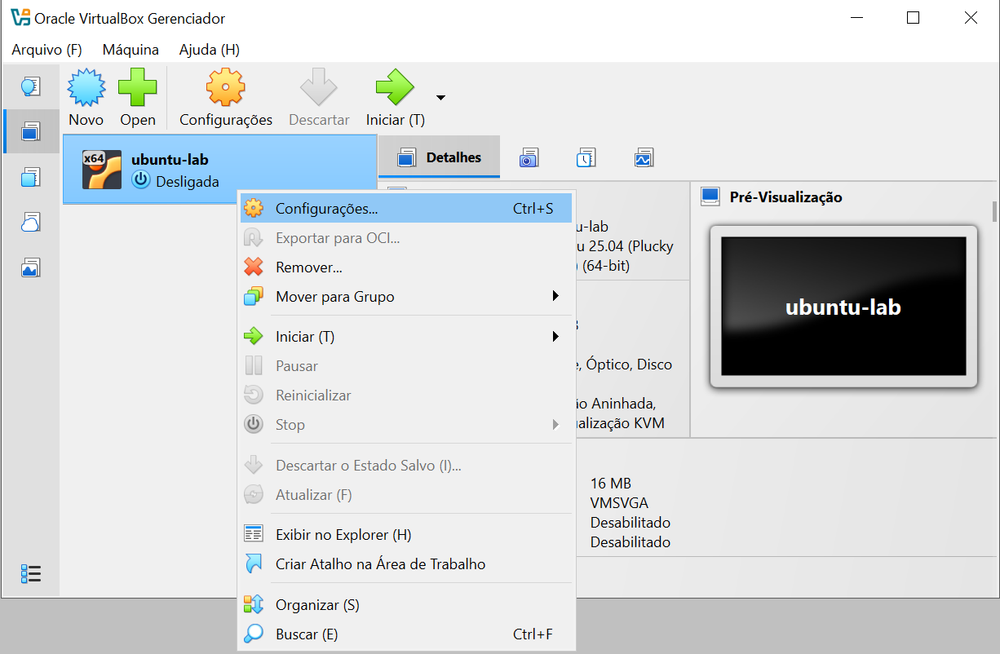 </p>
<p align="right"><i>(Imagem 08: Pastas Compartilhadas / VirtualBox)</i>

---

<br></br>

Na tela de Configurações, clique em **Pastas Compartilhadas**

<p align="center"> 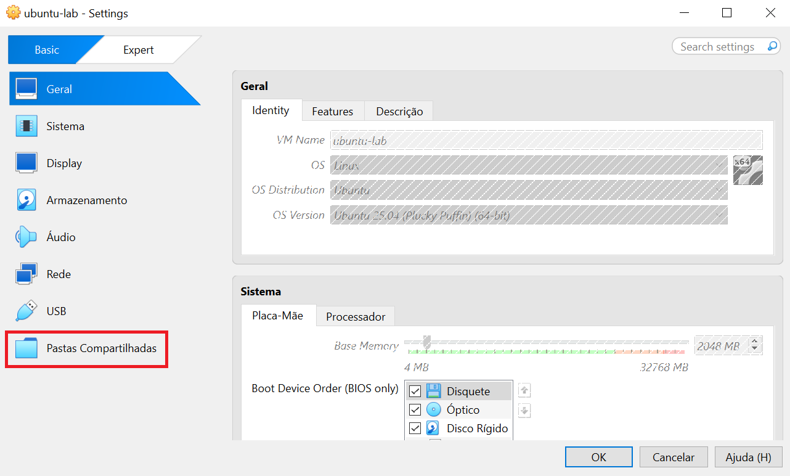 </p>
<p align="right"><i>(Imagem 09: Pastas Compartilhadas / VirtualBox)</i>

---

<br></br>

Clique no ícone para adiciona uma nova pasta compartilhada.

<p align="center"> 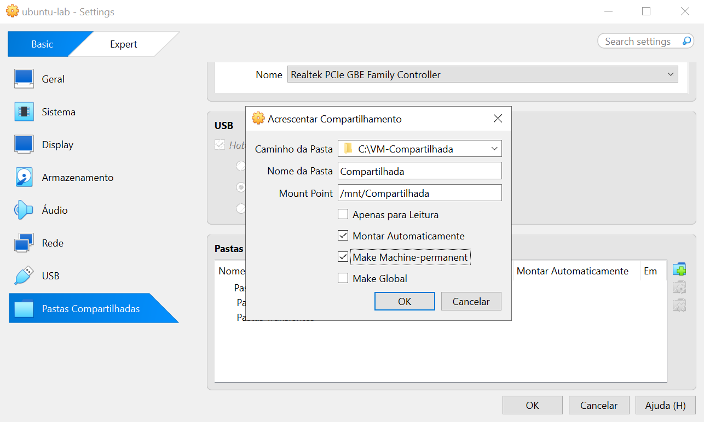 </p>
<p align="right"><i>(Imagem 10: Pastas Compartilhadas / VirtualBox)</i>

---

<br></br>

Adicione uma pasta com os seguintes parâmetros:**

- **Caminho da Pasta:** `C:\VM-Compartilhada`
- **Nome da Pasta:** `Compartilhada`
- **Mount Point:** `/mnt/Compartilhada`
- **Montagem Automática:** Habilitada
- **Make Machine-permanent:** Habilitada

Com os campos preenchidos, clique em <kbd>OK</kbd>

<p align="center">  </p>
<p align="right"><i>(Imagem 11: Pastas Compartilhadas / VirtualBox)</i>

---

<br></br>

Após adicionar a pasta compartilhada clique em <kbd>OK</kbd> para salvar as alterações.

<p align="center"> 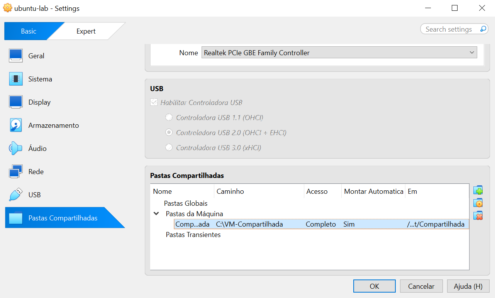 </p>
<p align="right"><i>(Imagem 12: Pastas Compartilhadas / VirtualBox)</i>

---

<br></br>


### 4.3. Acessar a pasta compartilhada na VM

Na máquina virtual (VM) Ubuntu Server, verifique se a pasta foi montada:

```bash
ls /mnt/Compartilhada/
```

O arquivo `.pem` deverá aparecer na listagem.

<p align="center">  </p>
<p align="right"><i>(Imagem 13: Verificando a chave na pasta compartilhada)</i>

---

<br></br>

Caso ocorra um erro de permissão ao tentar acessar a pasta compartilhada...

<p align="center"> 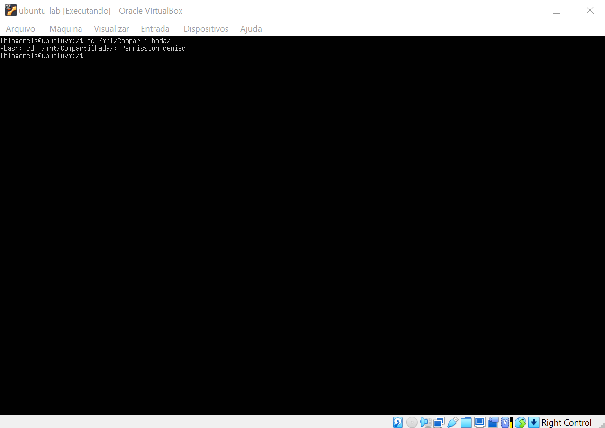 </p>
<p align="right"><i>(Imagem 14: Erro de permissão</i>

---

<br></br>

Verifique se o usuário da VM pertence ao grupo `vboxsf`. 

```bash
groups "$USER"
```

<p align="center"> 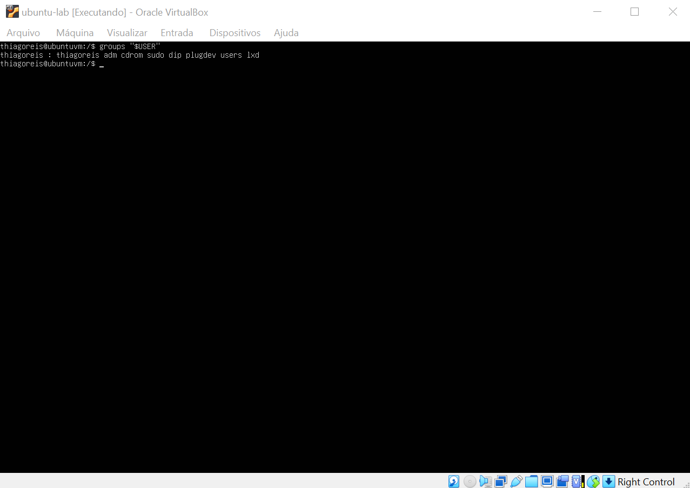 </p>
<p align="right"><i>(Imagem 15: Verificando grupos</i>

<br></br>

Na imagem anterior (imagem 15), o exemplo mostra que usuário não está no grupo `vboxsf`. Caso o usuário já pertença ao grupo `vboxsf`, reinicie o sistema ou saia da sessão atual com `logout` e acesse novamente.

Para adicionar o seu usuário atual ao grupo `vboxsf`, usado pelo VirtualBox para controlar o acesso as pastas compartilhadas entre o Windows e a máquina virtual (VM), utilize o comando:

```bash
sudo usermod -aG vboxsf "$USER"
```

<p align="center"> 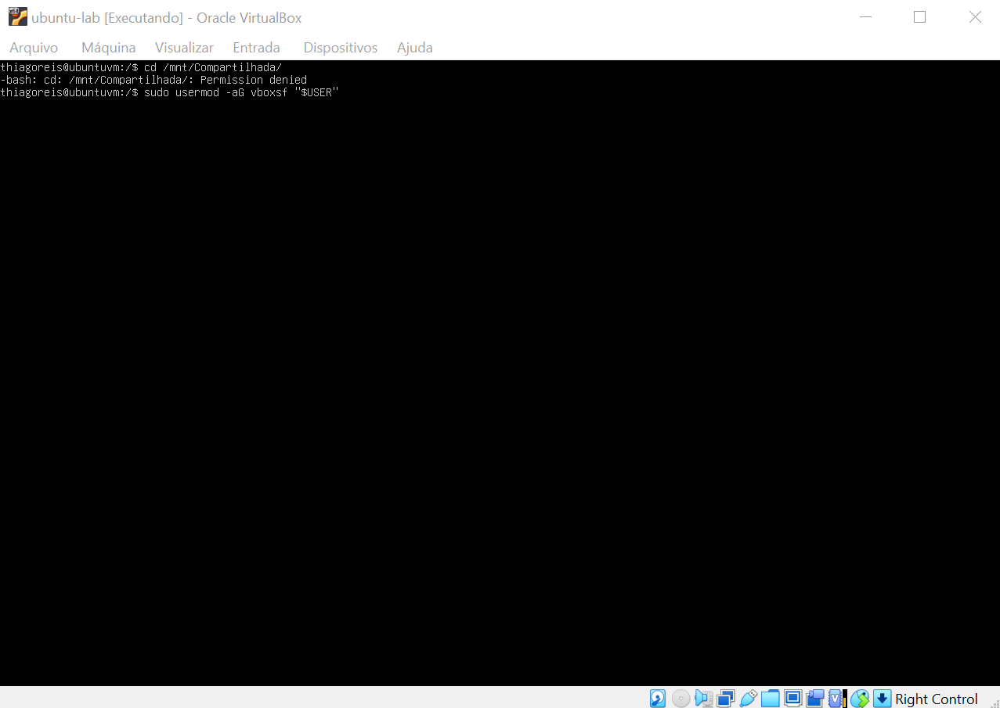 </p>
<p align="right"><i>(Imagem 16: Adicionando o usuário atual ao grupo vboxsf</i>

---

<br></br>

Digite a senha do usuário com permissão administrativa (sudo).

<p align="center"> 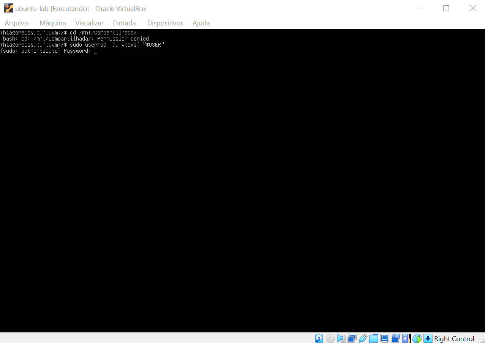 </p>
<p align="right"><i>(Imagem 17: Digite a senha do usuário</i>

---

<br></br>

Encerre a sessão atual do terminal e entre novamente para que a alteração tenha efeito.

```bash
logout
```

<p align="center"> 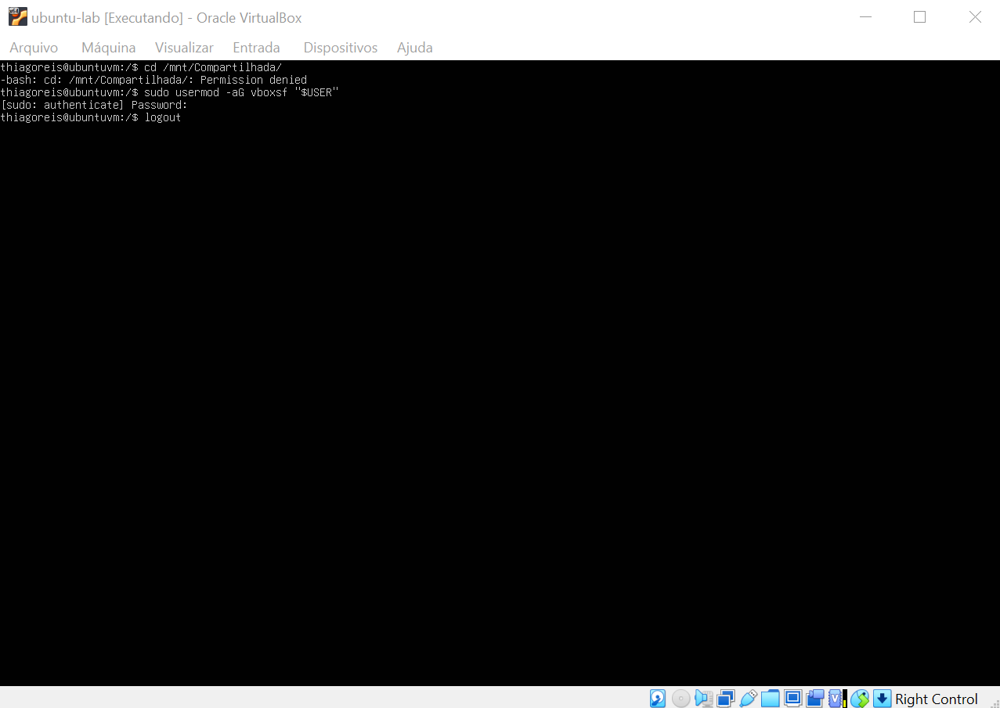 </p>
<p align="right"><i>(Imagem 18: Saindo da sessão no terminal</i>

---

<br></br>


### 4.4. Copiar e proteger a chave privada

Copie a chave para o diretório SSH, substituindo `nome-da-chave.pem` pelo nome real do arquivo:

```bash
cp /mnt/Compartilhada/nome-da-chave.pem ~/.ssh/chave-ec2-aws.pem
```
<p align="center"> 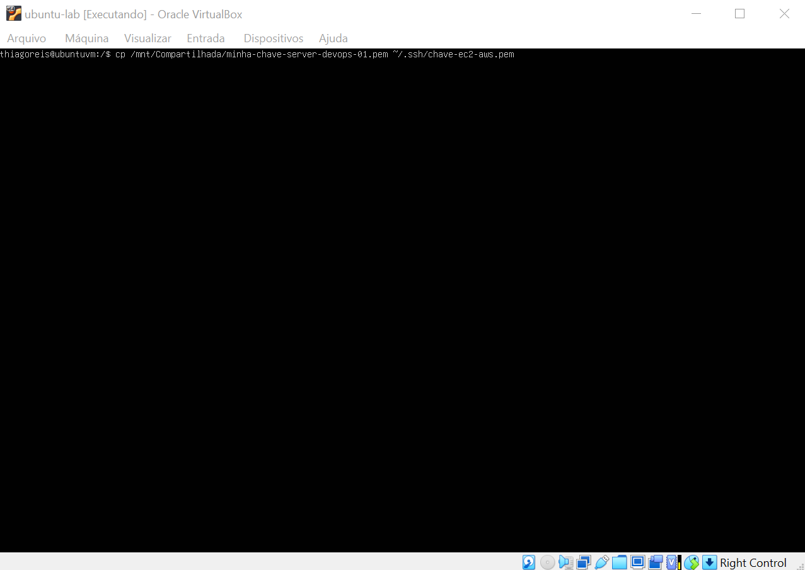 </p>
<p align="right"><i>(Imagem 18: Copiando a chave para a máquina virtual</i>

---

<br></br>

Para confirmar, veja se a chave foi copiada com o comando:

```bash
ls -l ~/.ssh/
```

<p align="center"> 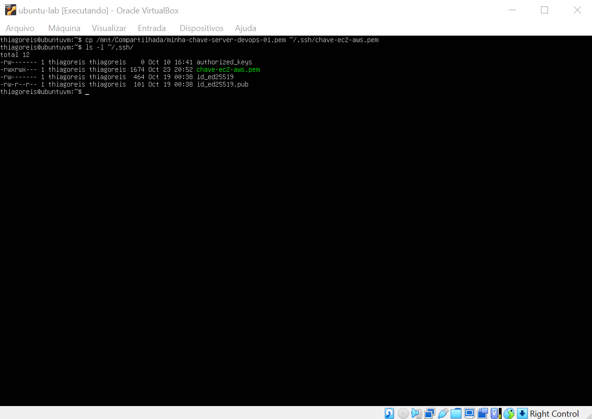 </p>
<p align="right"><i>(Imagem 19: Copiando a chave para a máquina virtual</i>

---

<br></br>

Restrinja as permissões da chave com o seguinte comando:

```bash
chmod 400 ~/.ssh/chave-ec2-aws.pem
```

<p align="center">  </p>
<p align="right"><i>(Imagem 20: Alterando as permissões da chave</i>

<br></br>

O comando `chmod 400` permite que somente o proprietário leia a chave privada.

**Importante:** Nunca publique ou compartilhe a chave privada `.pem` em repositórios Git ou outros locais públicos. Após confirmar a transferência, remova a cópia da chave da pasta compartilhada do Windows, se necessário.

<br></br>

Confirme a alteração das permissões da chave com o comando:


```bash
ls -l ~/.ssh/chave-ec2-aws.pem
```

<p align="center"> 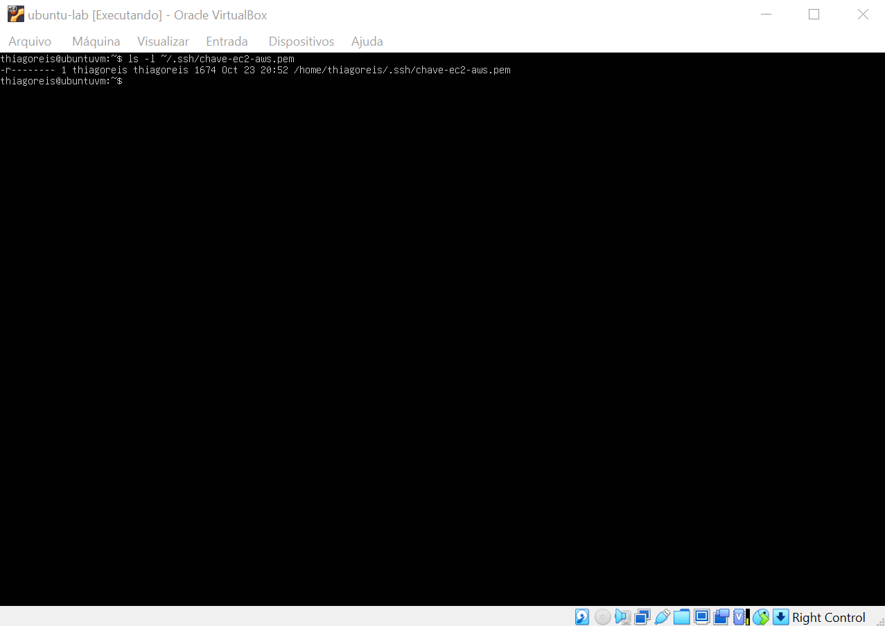 </p>
<p align="right"><i>(Imagem 21: Consultando as permissões da chave</i>

---

<br></br>

## 5. Acesso inicial à EC2

Para uma instância Ubuntu Server, execute na VM:

```bash
ssh -i ~/.ssh/chave-ec2-aws.pem ubuntu@IP_PUBLICO_DA_EC2
```

Substitua o `IP_PUBLICO_DA_EC2` pelo endereço IPv4 público da instância.

<p align="center"> 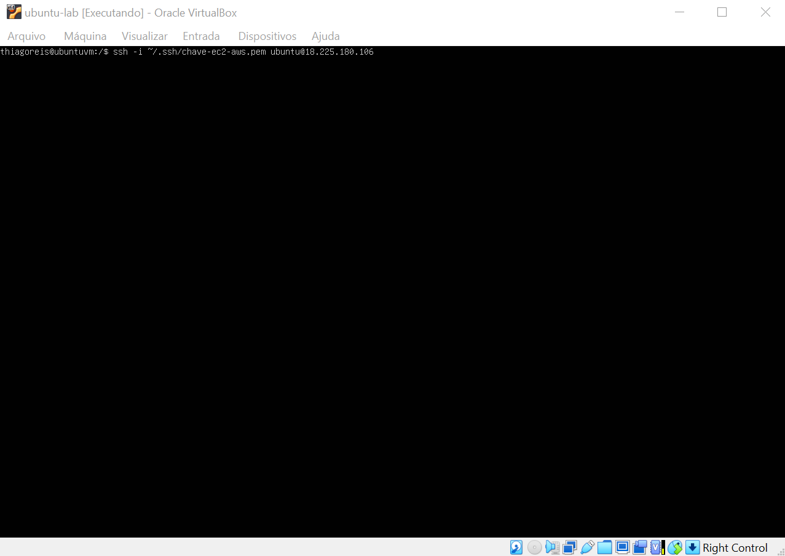 </p>
<p align="right"><i>(Imagem 22: Conectando via SSH / EC2)</i>

---

<br></br>

Na primeira conexão, confira a identidade do servidor antes de aceitar a sua chave de identificação. 

<p align="center"> 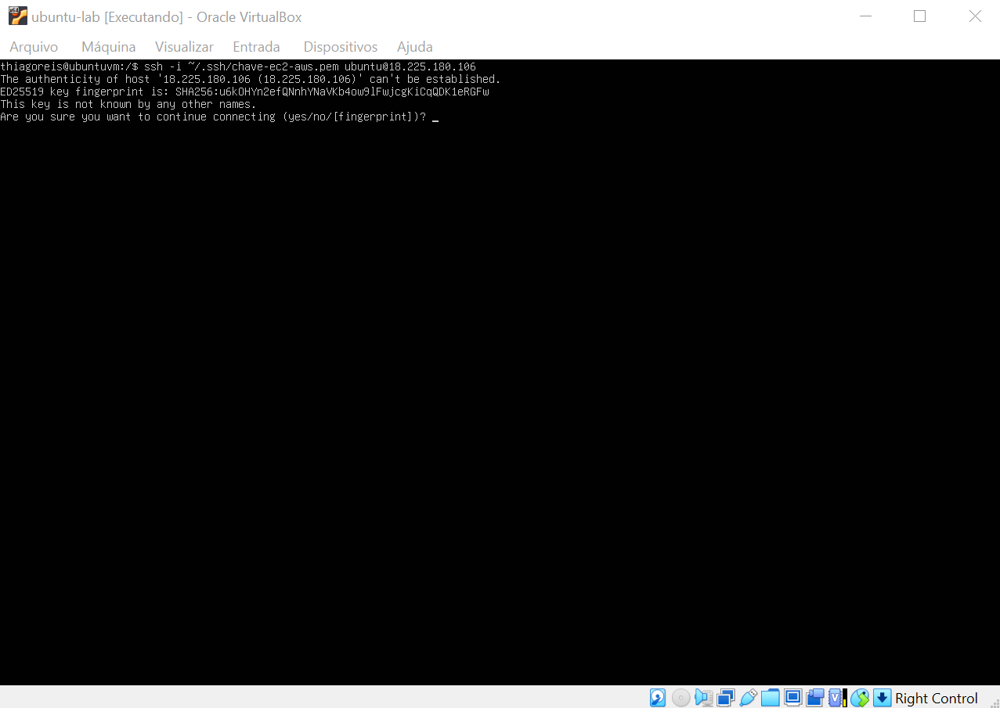 </p>
<p align="right"><i>(Imagem 23: Confirmação da Identidade / EC2)</i>

---

<br></br>

Digite "yes" para prosseguir.

<p align="center">  </p>
<p align="right"><i>(Imagem 24: Aguardando a confirmação / EC2)</i>

---

<br></br>

Com acesso autorizado será exibida a mensagem de boas vindas a instância EC2 Ubuntu Server.

<p align="center"> 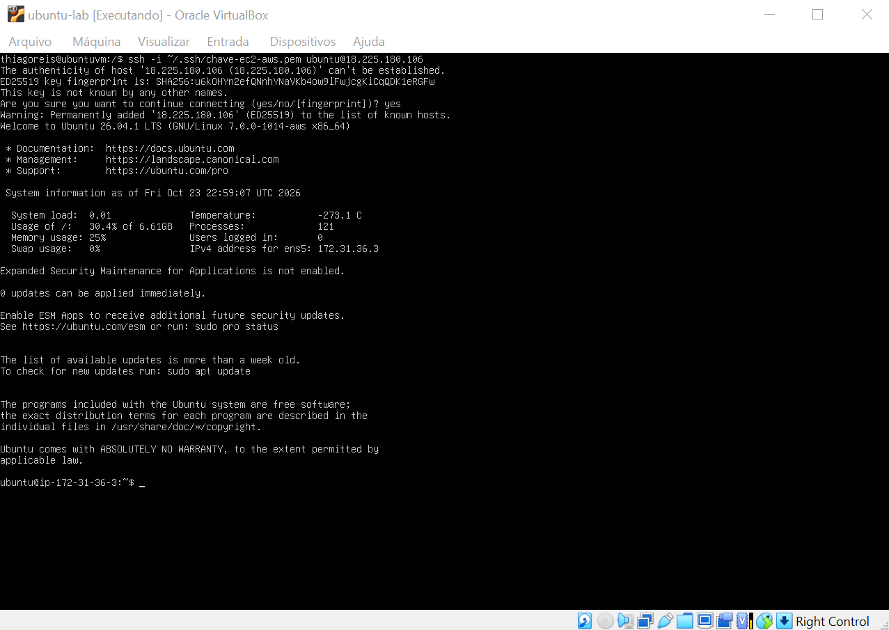 </p>
<p align="right"><i>(Imagem 25: Conectado / EC2)</i>

<br></br>

Após a confirmação de acesso, encerre a sessão:

```bash
exit
```

---

<p align="center"> 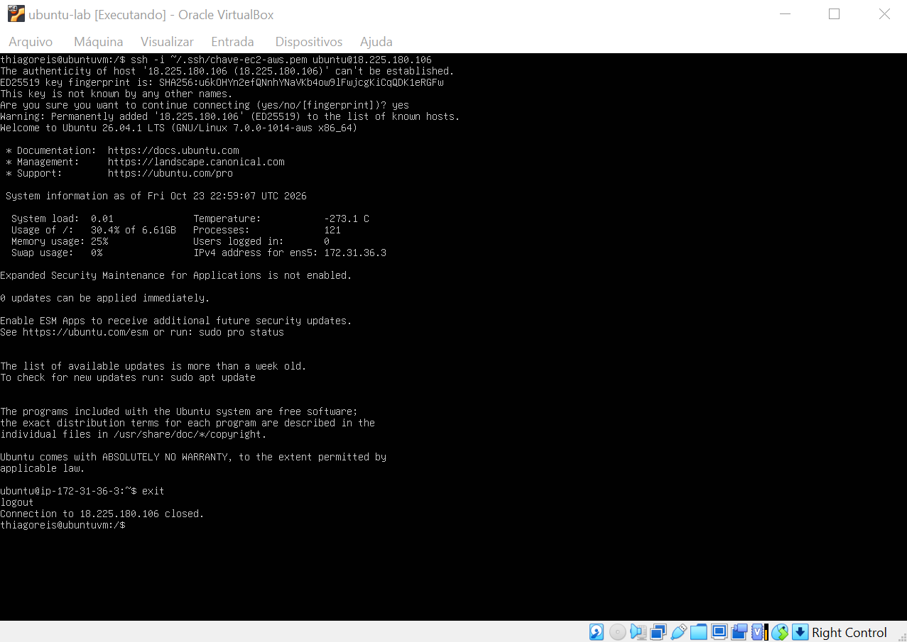 </p>
<p align="right"><i>(Imagem 26: Conectado / EC2)</i>

<br></br>

## 6. Instalar a chave pública da VM na EC2

Com o acesso inicial validado, execute na VM Ubuntu Server:

```bash
ssh-copy-id \
  -i ~/.ssh/id_ed25519.pub \
  -o "IdentityFile=$HOME/.ssh/chave-ec2-aws.pem" \
  -o "IdentitiesOnly=yes" \
  ubuntu@IP_PUBLICO_DA_EC2
```

Substitua `IP_PUBLICO_DA_EC2` pelo endereço IPv4 público da instância.

<p align="center"> 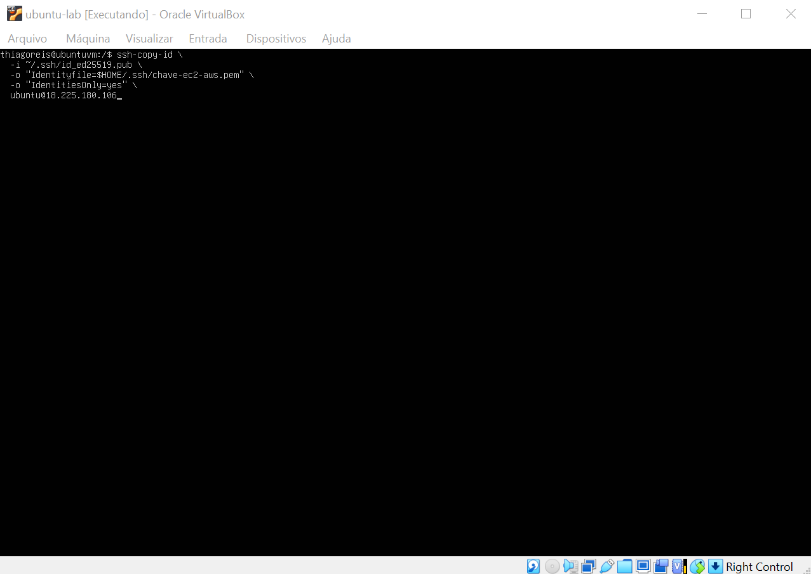 </p>
<p align="right"><i>(Imagem 27: Executando o comando ssh-copy-id)</i>

<br></br>

O comando a seguir é o mesmo do passo anterior. Se preferir utilizar um comando único:

```bash
ssh-copy-id -f -i ~/.ssh/id_ed25519.pub -o "IdentityFile=$HOME/.ssh/chave-ec2-aws.pem" -o "IdentitiesOnly=yes" ubuntu@IP_PUBLICO_DA_EC2
```bash

<p align="center">  </p>
<p align="right"><i>(Imagem 28: Executando o comando ssh-copy-id)</i>

<br></br>


O comando utiliza a chave privada da AWS para autenticar a conexão inicial e instala a chave pública pessoal da VM no arquivo `~/.ssh/authorized_keys` do usuário remoto.

Caso seja solicitada uma confirmação da identidade do servidor, confira a chave apresentada antes de aceitar.

<p align="center"> 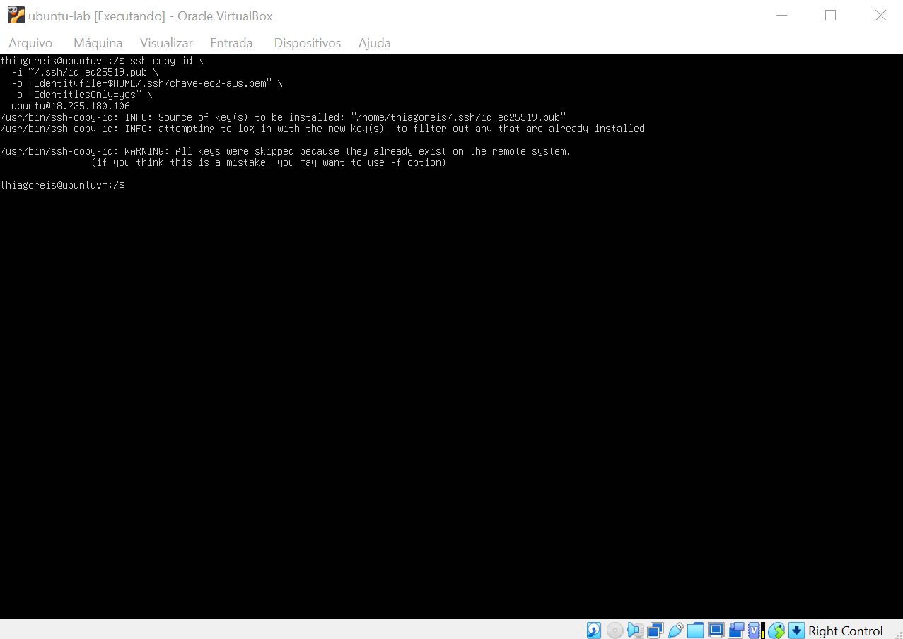 </p>
<p align="right"><i>(Imagem 29: Executando o comando ssh-copy-id)</i>

<br></br>


---

<br></br>

## 7. Testar o acesso com a chave pessoal

Após instalar a chave pública, teste uma nova conexão utilizando a chave privada pessoal da VM:

```bash
ssh -i ~/.ssh/id_ed25519 ubuntu@IP_PUBLICO_DA_EC2
```

<p align="center"> 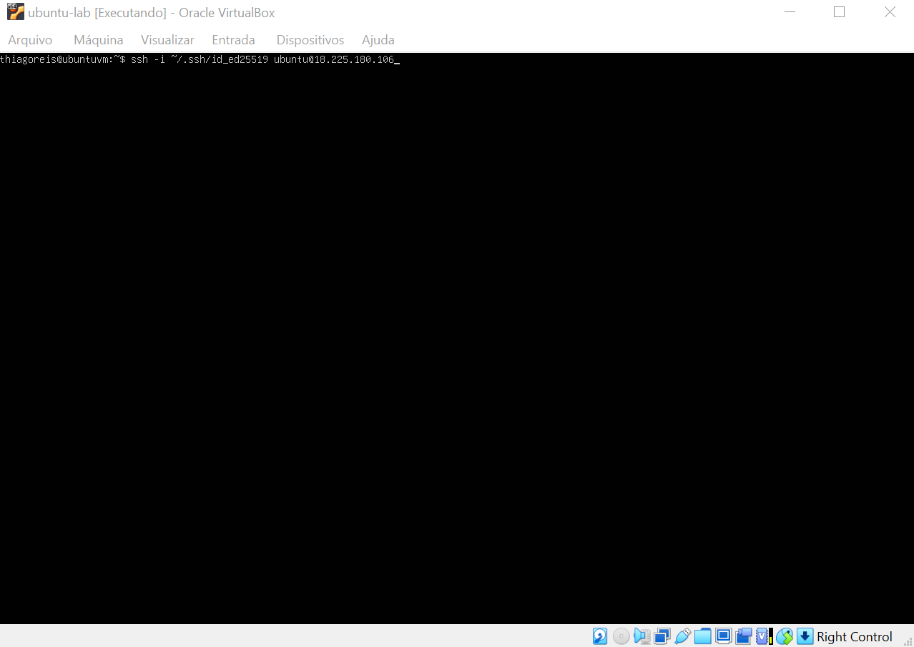 </p>
<p align="right"><i>(Imagem 30: Conectando na EC2)</i>

<br></br>

Caso a conexão seja estabelecida, a chave pessoal está funcionando para autenticação na EC2.

Para verificar o usuário conectado, execute:

```bash
whoami
```

Para encerrar a sessão:

```bash
exit
```

---

<br></br>

## 8. Configurar um alias SSH

Após validar o acesso por chave pessoal, é possível criar um alias para simplificar as próximas conexões.

Abra o arquivo de configuração SSH:

```bash
vim ~/.ssh/config
```

Adicione a configuração abaixo:

```sshconfig
Host ec2-lab
    HostName IP_PUBLICO_DA_EC2
    User ubuntu
    IdentityFile ~/.ssh/id_ed25519
    IdentitiesOnly yes
```

Substitua `IP_PUBLICO_DA_EC2` pelo endereço IPv4 público da instância.

Salve o arquivo e ajuste suas permissões:

```bash
chmod 600 ~/.ssh/config
```

Para conectar utilizando o alias, execute:

```bash
ssh ec2-lab
```

O alias permite utilizar um nome curto para a conexão, sem precisar informar o endereço IP e o caminho da chave em cada comando.

---

<br></br>

## 9. Observações de segurança

- Nunca compartilhe ou publique chaves privadas `.pem` ou `id_ed25519`.
- Somente a chave pública `.pub` deve ser instalada no servidor.
- Restrinja as regras de entrada SSH no Security Group aos endereços IP confiáveis.
- A VM precisa ter conectividade de rede com a EC2 pela porta TCP 22.
- O endereço IPv4 público pode mudar após a instância ser parada e iniciada novamente, dependendo da configuração utilizada.
- Para instâncias Amazon Linux, o usuário padrão geralmente é `ec2-user`, em vez de `ubuntu`.

---

<br></br>

## Referências

- [OpenSSH](https://www.openssh.com/)
- [Manual do ssh-copy-id](https://manpages.ubuntu.com/manpages/noble/en/man1/ssh-copy-id.1.html)
- [Documentação da AWS: conexão SSH com instâncias Linux](https://docs.aws.amazon.com/AWSEC2/latest/UserGuide/connect-linux-inst-ssh.html)

